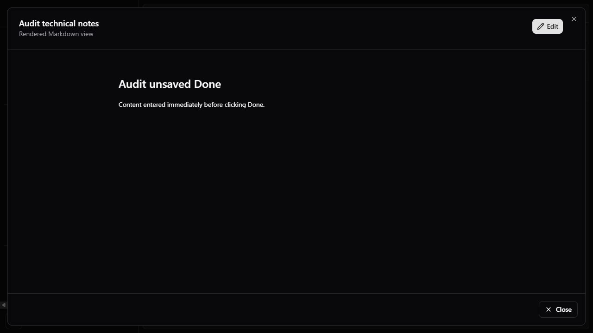
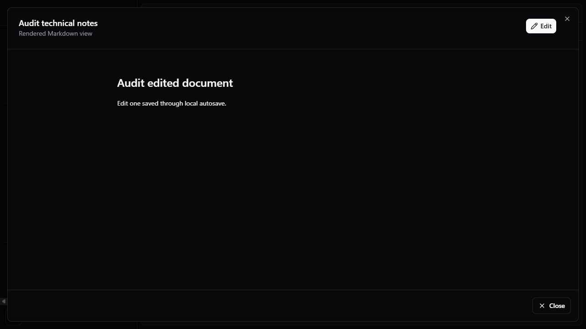
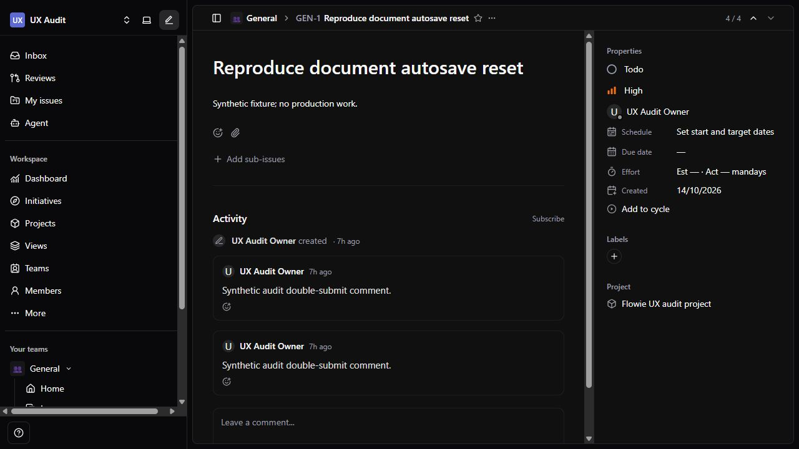
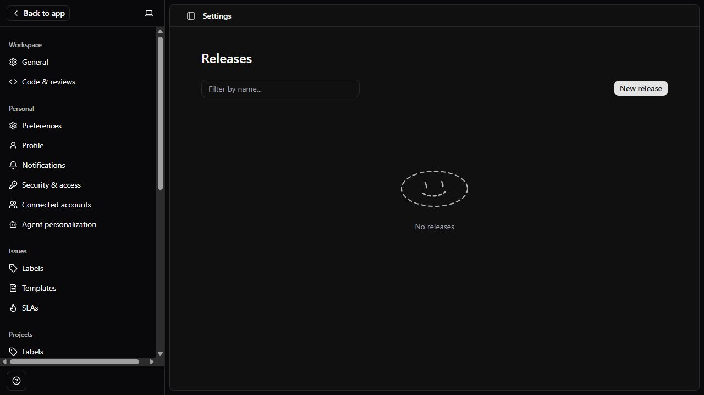
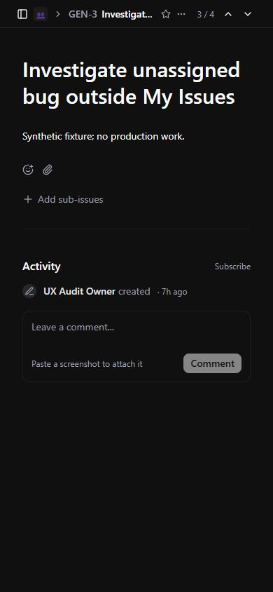
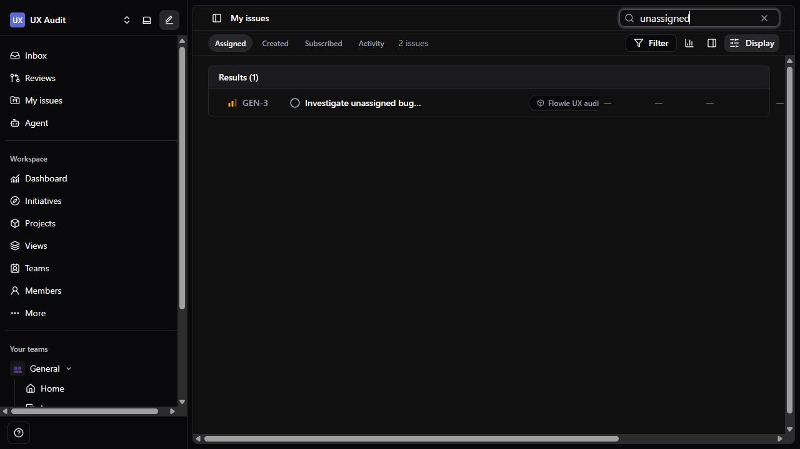
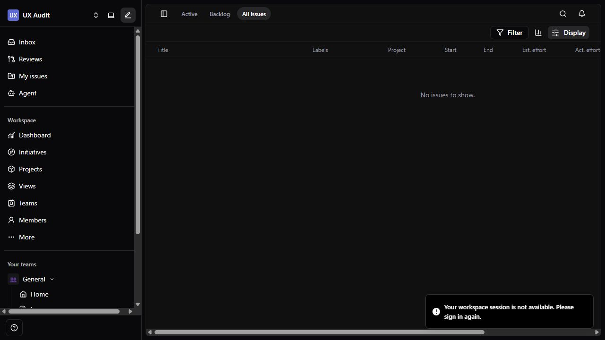
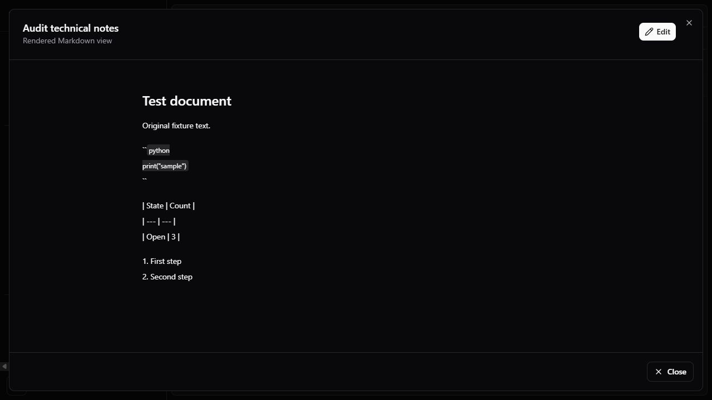

# Flowie — Rà soát UI, UX và chức năng ứng dụng

- Ngày rà soát: 2026-10-14, Asia/Saigon (+07).
- Mã nguồn đối chiếu: `aebc51f463ccb0bae269a9f788b4b7629d6de191`.
- URL người dùng xác nhận: `https://flowie.loopstudio.io.vn`.
- Kết quả: **17 đầu việc cải tiến hiện hữu: 8 P1, 9 P2; thêm 6 đề xuất chức năng**.
- Trạng thái các đầu việc: `OPEN`; báo cáo này ghi nhận phát hiện, chưa sửa ứng dụng.

## 1. Phạm vi và mức độ bằng chứng

Production được kiểm tra ở màn hình đăng nhập. Phiên trình duyệt rà soát không
có đăng nhập production; các luồng phía sau đăng nhập được kiểm tra trên bản
production build chạy local với API thật và database tổng hợp riêng.

Database thử áp dụng thành công toàn bộ 79 migration đã commit. Dataset gồm một
workspace, một team, một project, một thành viên, bốn issue và một tài liệu.
Kiểm tra desktop ở 1280 × 720; kiểm tra trang issue ở 390 × 844. Database và
server thử đã được dọn/dừng sau khi thu bằng chứng; không sửa dữ liệu CT107.

Phân loại bằng chứng:

- **UI + DB**: tái hiện bằng thao tác trình duyệt và đối chiếu database thử.
- **UI + code**: tái hiện bằng trình duyệt và xác định nguyên nhân trong code.
- **Code**: xác nhận đường code hiện hữu; chưa tái hiện trên production.
- **Đề xuất**: phần sản phẩm nên bổ sung, không được tính là lỗi đã tái hiện.

P1 là lỗi có thể làm mất nội dung, tạo dữ liệu trùng, chặn luồng công việc hoặc
hiển thị sai dữ liệu chính. P2 là lỗi điều hướng, tính nhất quán, trải nghiệm,
khả năng truy cập hoặc rủi ro mở rộng. Chưa ghi nhận P0 trong phạm vi này.

## 2. Danh sách ưu tiên

| ID | Ưu tiên | Phát hiện | Bằng chứng | Hướng xử lý |
| --- | --- | --- | --- | --- |
| UX-01 | P1 | Bấm Done nhanh làm hủy autosave tài liệu; reload mất phần mới nhập | UI + DB | Flush save khi Done/Close, theo dõi dirty state, giữ draft khi lỗi |
| UX-02 | P1 | Double-click Comment tạo hai bình luận giống nhau | UI + DB | Khóa gửi khi pending; bảo vệ submit từ chuột và bàn phím |
| UX-03 | P1 | Năm trang Settings vẫn render placeholder, nút tạo/upload không hoạt động | UI + code | Nối route vào component/API đã có, kiểm tra quyền và trạng thái lỗi |
| UX-04 | P1 | Bấm thành viên thật bị chuyển về Teams; hồ sơ vẫn đọc mock users | UI + code | Đọc member theo workspace/user ID thật; bỏ pseudo-creator |
| UX-05 | P1 | Mobile 390px không có đường UI sửa trạng thái, priority, assignee trên trang issue | UI + code | Sheet hoặc tab Properties cho màn hình hẹp |
| UX-06 | P1 | Search của My issues bỏ phạm vi Assigned và trả issue chưa được giao | UI + code | Tìm kiếm trên tập scoped/filtered, hoặc công bố rõ phạm vi toàn workspace |
| UX-07 | P1 | Tài liệu và activity vừa tạo hiển thị 7h ago | UI + code | Chuẩn hóa timestamp UTC có offset; dùng chung formatter |
| UX-08 | P1 | API mất kết nối bị hiển thị thành No issues to show | UI + code | Phân biệt error/empty, giữ dữ liệu cũ, cung cấp Retry |
| UX-09 | P2 | Checkbox thông báo chỉ thay đổi state React, reload trở về false | UI + code | Nối preference API hoặc bỏ trạng thái bật giả |
| UX-10 | P2 | Attach file, Add reaction, Subscribe và một số nút Help không có handler | UI + code | Thực hiện hành động hoặc hiển thị unavailable rõ ràng |
| UX-11 | P2 | Markdown preview hiển thị code fence và bảng như text | UI + code | Markdown renderer dùng chung, có kiểm soát nội dung/URL |
| UX-12 | P2 | Bấm badge project của issue mở danh sách Projects thay vì project đó | UI + code | Dùng URL project detail theo ID |
| UX-13 | P2 | AI & Agents vẫn báo tất cả unavailable và dùng tên LNDev Agent | UI + code | Hiển thị capability thực tế, dẫn tới MCP/Agent settings |
| UX-14 | P2 | Ngôn ngữ và ký hiệu phím tắt thiếu nhất quán trên Windows | UI + code | Chuẩn hóa locale và nhãn Ctrl/⌘ theo nền tảng |
| UX-15 | P2 | Một số icon button/textarea không có accessible name rõ ràng | UI + code | Label/aria-label theo hành động, kiểm tra keyboard/focus |
| UX-16 | P2 | Web tải toàn bộ issue; API dựng chi tiết từng issue theo nhiều truy vấn | Code | Phân trang/filter server, batch hydration và giảm tải detail |
| UX-17 | P2 | Assignee đang online vẫn được hiển thị offline ở issue | UI + code | Dùng presence thật hoặc bỏ trạng thái chưa có dữ liệu |

## 3. Chi tiết các lỗi P1

### UX-01 — Done không lưu nội dung đang chờ autosave

**Tái hiện:** mở tài liệu Markdown → Edit → sửa nội dung → bấm Done trước khi
hết 800ms → reload → mở lại tài liệu. Nội dung mới biến mất. Đối chiếu DB vẫn
giữ bản đã autosave trước đó, trong khi View mode trước reload hiển thị bản mới.

**Nguyên nhân:** effect chỉ autosave khi `mode === 'edit'`; Done chỉ gọi
`setMode('view')`, khiến cleanup hủy timer. Close gọi save nhưng không đợi kết
quả rồi đóng modal. Draft chỉ nằm trong state component, chưa có cơ chế lưu bền
khi save lỗi hoặc điều hướng.

**Vị trí:** [markdown-document-editor.tsx:195](<C:/Users/Hoang Tu/Desktop/BSR/1. Source Code/Flowie/apps/web/components/common/teams/markdown-document-editor.tsx:195>),
[Done:230](<C:/Users/Hoang Tu/Desktop/BSR/1. Source Code/Flowie/apps/web/components/common/teams/markdown-document-editor.tsx:230>).

**Nghiệm thu:** Done flush đúng draft mới nhất và chỉ báo saved sau thành công;
Close/điều hướng khi pending hoặc lỗi không âm thầm bỏ draft; autosave không gửi
các bản cũ ghi đè bản mới. Kiểm thử save chậm, lỗi, liên tiếp và reload.

### UX-02 — Bình luận gửi trùng

**Tái hiện:** nhập một bình luận vào task thử → double-click Comment. UI hiển
thị hai bình luận; truy vấn DB xác nhận hai row cùng issue/content.

**Nguyên nhân:** `submitComment` không có pending guard; nút không disabled khi
đang gửi. Đường Ctrl/⌘+Enter cũng gọi cùng hàm mà không kiểm tra đang gửi. Lỗi
network chưa được catch trong hàm gửi để phản hồi và giữ retry state rõ ràng.

**Vị trí:** [activity-feed.tsx:187](<C:/Users/Hoang Tu/Desktop/BSR/1. Source Code/Flowie/apps/web/components/common/issues/details/activity-feed.tsx:187>).

**Nghiệm thu:** double-click và nhấn shortcut liên tiếp tạo một bình luận cho
một lần gửi; nút có pending state; lỗi giữ nguyên draft. Nếu bổ sung retry sau
timeout, dùng request key và deduplication trên server cho cùng logical submit.

### UX-03 — Settings chưa nối chức năng đã có

Các route **SLAs, Releases, Customer requests, Asks, Emojis** cùng import
`SettingsPlaceholder`. Component này luôn hiển thị empty state, filter không
có state/handler và action button không có onClick. Đã bấm New release trên UI
và không có dialog hay thay đổi trạng thái.

Các component riêng `slas-settings.tsx`, `releases-settings.tsx`,
`customer-requests-settings.tsx`, `asks-settings.tsx`, `emojis-settings.tsx` và
backend tương ứng đã có. Đây là vấn đề nối route, không nên mặc định viết lại
toàn bộ nghiệp vụ.

**Vị trí:** [settings-placeholder.tsx:67](<C:/Users/Hoang Tu/Desktop/BSR/1. Source Code/Flowie/apps/web/components/common/settings/settings-placeholder.tsx:67>),
[Releases route:9](<C:/Users/Hoang Tu/Desktop/BSR/1. Source Code/Flowie/apps/web/app/[orgId]/settings/releases/page.tsx:9>).

**Nghiệm thu:** mỗi route render đúng component; dữ liệu thật, quyền member/admin,
create/edit/archive/upload, empty/loading/error và reload đều hoạt động. Không
coi việc component đã tồn tại hoặc build thành công là nghiệm thu UI.

### UX-04 — Hồ sơ thành viên thật dùng dữ liệu mẫu

**Tái hiện:** Members hiển thị UX Audit Owner từ API → bấm tên → bị chuyển về
Teams. Route tìm ID trong `mock-data/users`, không tìm thấy thì `notFound()`;
global not-found lại redirect `/`, làm mất thông tin lỗi. Tab Created trong
profile/header còn dùng hàm hash `issueCreatorIndex` để giả lập tác giả.

**Vị trí:** [profile route:13](<C:/Users/Hoang Tu/Desktop/BSR/1. Source Code/Flowie/apps/web/app/[orgId]/profiles/[memberId]/page.tsx:13>),
[member-profile.tsx:121](<C:/Users/Hoang Tu/Desktop/BSR/1. Source Code/Flowie/apps/web/components/common/members/member-profile.tsx:121>),
[not-found.tsx:4](<C:/Users/Hoang Tu/Desktop/BSR/1. Source Code/Flowie/apps/web/app/not-found.tsx:4>).

**Nghiệm thu:** hồ sơ member thật mở được từ danh sách/deep link; Created dựa vào
`creatorId`; unknown/inaccessible member có thông báo và đường quay lại phù hợp.

### UX-05 — Thuộc tính issue không sử dụng được trên mobile

**Tái hiện:** trang issue có Properties ở desktop. Ở 390 × 844 panel bị ẩn hoàn
toàn. Menu Issue actions chỉ có Rename, Due date, Move to team, Subscribe,
Copy link, Delete; không có Status, Priority hoặc Assignee.

**Vị trí:** [issue-details.tsx:104](<C:/Users/Hoang Tu/Desktop/BSR/1. Source Code/Flowie/apps/web/components/common/issues/details/issue-details.tsx:104>).

**Nghiệm thu:** có nút Properties hoặc controls trực tiếp trên mobile/tablet;
người dùng đọc/sửa được các thuộc tính chính; drawer có label, focus trap và
đóng được bằng keyboard. Kiểm tra 390px, 768px và breakpoint 1024px.

### UX-06 — Search bỏ phạm vi tab/filter

**Tái hiện:** My issues → Assigned có hai task. Search `unassigned` trả GEN-3
không có assignee; header vẫn ở Assigned. Đây là sai lệch UX về phạm vi tìm
kiếm, chưa phải bằng chứng vượt quyền server.

**Nguyên nhân:** nhánh search render `SearchIssues` độc lập; component tìm trong
toàn bộ issue store, không nhận `scopedIssues`/`displayedIssues`. Cùng cấu trúc
được dùng ở All issues; cần kiểm tra thêm Active/Backlog và filter khi sửa.

**Vị trí:** [my-issues.tsx:56](<C:/Users/Hoang Tu/Desktop/BSR/1. Source Code/Flowie/apps/web/components/common/my-issues/my-issues.tsx:56>),
[search-issues.tsx:21](<C:/Users/Hoang Tu/Desktop/BSR/1. Source Code/Flowie/apps/web/components/common/issues/search-issues.tsx:21>).

**Nghiệm thu:** search giữ scope/filter hiện hành, hoặc có chế độ tìm toàn
workspace được ghi rõ; kết quả cập nhật khi data store đổi; không mang query
sang trang khác ngoài ý muốn.

### UX-07 — Timestamp thiếu timezone làm lệch thời gian tương đối

**Tái hiện:** tài liệu và issue activity vừa được tạo trong dataset thử hiển
thị `7h ago`. Thời điểm database được tạo bằng `_utcnow()`; API trả datetime
naive không có offset, UI parse như thời gian local ở múi giờ +07.

**Vị trí:** [document_repository.py:53](<C:/Users/Hoang Tu/Desktop/BSR/1. Source Code/Flowie/apps/api-python/app/modules/work_items/document_repository.py:53>),
[team-documents.tsx:54](<C:/Users/Hoang Tu/Desktop/BSR/1. Source Code/Flowie/apps/web/components/common/teams/team-documents.tsx:54>),
[activity-feed.tsx:66](<C:/Users/Hoang Tu/Desktop/BSR/1. Source Code/Flowie/apps/web/components/common/issues/details/activity-feed.tsx:66>).

**Nghiệm thu:** instant timestamp trả ISO 8601 có `Z`/offset; formatter dùng
chung cho activity, document, notification, session. Date-only như deadline
phải được xử lý riêng để không lệch ngày. Test UTC, +07 và timezone có DST.

### UX-08 — Lỗi tải dữ liệu bị biến thành danh sách rỗng

**Tái hiện:** All issues có bốn row → dừng API thử → chuyển Active rồi quay lại
All issues → UI hiển thị No issues to show. Toast còn báo session không khả
dụng dù nguyên nhân là API ngừng phản hồi. Không có Retry ngay tại danh sách.

**Nguyên nhân:** `loadIssues` catch và xóa issues/options, không lưu `error`.
Activity feed cũng catch rồi đặt mảng trống; issue detail có thể báo not found
khi lỗi load. Network, 401, 403, 404 và empty result cần được phân biệt.

**Vị trí:** [issues-store.ts:347](<C:/Users/Hoang Tu/Desktop/BSR/1. Source Code/Flowie/apps/web/store/issues-store.ts:347>),
[activity-feed.tsx:170](<C:/Users/Hoang Tu/Desktop/BSR/1. Source Code/Flowie/apps/web/components/common/issues/details/activity-feed.tsx:170>).

**Nghiệm thu:** báo lỗi có Retry; refresh thất bại giữ snapshot cũ và đánh dấu
stale; phiên hết hạn có đường đăng nhập; empty thật có hướng tạo dữ liệu. Khi
đổi workspace phải xóa snapshot khác workspace để giữ đúng ranh giới dữ liệu.

## 4. Chi tiết các cải tiến P2

| ID | Vị trí/hiện tượng | Thay đổi và tiêu chí nghiệm thu |
| --- | --- | --- |
| UX-09 | [notifications.tsx:11](<C:/Users/Hoang Tu/Desktop/BSR/1. Source Code/Flowie/apps/web/components/layout/headers/issues/notifications.tsx:11>): checkbox bật rồi reload mất; Configure không có hành động | Nối preference API có sẵn sau khi chốt semantics user/team. Save pending/error và reload phải giữ lựa chọn. Show snoozed trong Inbox cũng có control nhưng filter chưa triển khai; disable rõ hoặc làm đầy đủ scheduler/state. |
| UX-10 | [issue-details.tsx:82](<C:/Users/Hoang Tu/Desktop/BSR/1. Source Code/Flowie/apps/web/components/common/issues/details/issue-details.tsx:82>), [activity-feed.tsx:209](<C:/Users/Hoang Tu/Desktop/BSR/1. Source Code/Flowie/apps/web/components/common/issues/details/activity-feed.tsx:209>), [help-button.tsx:32](<C:/Users/Hoang Tu/Desktop/BSR/1. Source Code/Flowie/apps/web/components/layout/sidebar/help-button.tsx:32>) | Attach file và Add reaction đã bấm nhưng không phản hồi; Subscribe ở Activity, Help search/Keyboard shortcuts không có handler. Nối thao tác thật, có success/error; chưa hỗ trợ thì disable và nêu lý do. |
| UX-11 | [markdown-document-editor.tsx:65](<C:/Users/Hoang Tu/Desktop/BSR/1. Source Code/Flowie/apps/web/components/common/teams/markdown-document-editor.tsx:65>): parser chỉ hỗ trợ một phần Markdown | Render đúng fenced code, ordered list, GFM table/task list và heading semantics. Dùng chung parser cho view/edit preview và nội dung AI; không cho raw HTML/URL nguy hiểm. Ảnh bằng chứng ở mục 5. |
| UX-12 | [project-badge.tsx:11](<C:/Users/Hoang Tu/Desktop/BSR/1. Source Code/Flowie/apps/web/components/common/issues/project-badge.tsx:11>) | Link tới `/{org}/project/{id}/overview`; click badge đi đúng project và giữ navigation có ý nghĩa. |
| UX-13 | [ai-agents.tsx:43](<C:/Users/Hoang Tu/Desktop/BSR/1. Source Code/Flowie/apps/web/components/common/settings/ai-agents.tsx:43>) | Tách Agent phân tích, MCP scoped access và external coding runner; hiển thị từng capability/config thực tế. Thay LNDev bằng Flowie và dẫn tới Integrations/Agent personalization. Không công bố runner tự thực thi khi chưa có. |
| UX-14 | Login production/local tiếng Việt; task/settings chủ yếu tiếng Anh; [issue-description.tsx:89](<C:/Users/Hoang Tu/Desktop/BSR/1. Source Code/Flowie/apps/web/components/common/issues/details/issue-description.tsx:89>) luôn ghi ⌘↵ | Chốt default locale và catalog chuỗi; chuẩn hóa ngày/số/đơn vị effort. Hint phím tắt Windows là Ctrl, macOS là ⌘. Không cần đổi tất cả nhãn trong một PR. |
| UX-15 | AX snapshot có nút icon không tên; [help-button.tsx:24](<C:/Users/Hoang Tu/Desktop/BSR/1. Source Code/Flowie/apps/web/components/layout/sidebar/help-button.tsx:24>) và [activity-feed.tsx:222](<C:/Users/Hoang Tu/Desktop/BSR/1. Source Code/Flowie/apps/web/components/common/issues/details/activity-feed.tsx:222>) | Accessible name cho icon control, label cho comment composer; h1–h3 đúng semantic; keyboard/focus-visible và mobile touch target. Nghiệm thu với kiểm tra tự động lẫn keyboard thực tế. |
| UX-16 | [native_issues.py:145](<C:/Users/Hoang Tu/Desktop/BSR/1. Source Code/Flowie/apps/api-python/app/domains/native_issues.py:145>) không có limit/cursor; gọi `_issue_row` lần lượt; [issue-details.tsx:28](<C:/Users/Hoang Tu/Desktop/BSR/1. Source Code/Flowie/apps/web/components/common/issues/details/issue-details.tsx:28>) tải cả store | Thêm truy vấn server theo scope/project/search/cursor, batch quan hệ, endpoint detail dùng thẳng ID/key và virtualization khi cần. Đây là rủi ro từ code, chưa đo tải production; ghi baseline query count/p95 với 1k/10k issue trước tối ưu. |
| UX-17 | [issues-store.ts:147](<C:/Users/Hoang Tu/Desktop/BSR/1. Source Code/Flowie/apps/web/store/issues-store.ts:147>) và `asMember` đặt offline cố định; Members của cùng người báo Online now | Dùng `lastSeenAt`/`isOnline` thật nếu hiển thị presence; không giả offline khi options API chưa trả dữ liệu. Kiểm tra nhất quán Members/assignee/project lead. |

## 5. Bằng chứng Markdown

Tài liệu thử chứa fenced Python code, bảng và numbered list. Parser hiện tại
hiển thị dấu fence và pipe của bảng thành text; ordered list không trở thành
list semantic. Không cần suy đoán từ tên file: đã kiểm tra trực tiếp View mode.

## 6. Chức năng nên bổ sung

Các mục này là đề xuất sản phẩm; cần tách khỏi bug list để quản lý scope.

| ID | Ưu tiên | Chức năng | Khoảng thiếu hiện tại | Tiêu chí kết quả |
| --- | --- | --- | --- | --- |
| FEAT-01 | P1 | UI lịch sử tài liệu và xử lý xung đột người–AI | MCP đã có revision/diff/restore; UI document không có lịch sử và không gửi expectedVersion khi ghi | Xem diff, khôi phục tạo revision mới, cảnh báo stale version, giữ draft và hướng dẫn reconcile |
| FEAT-02 | P2 | Luồng bug có cấu trúc | Issue hiện dùng title/description/priority/labels; bug template chưa phải các trường có cấu trúc | Type bug/task, severity, môi trường, bước tái hiện, expected/actual; filter/report và MCP tương ứng sau migration |
| FEAT-03 | P2 | Bình luận đầy đủ: sửa, phản hồi, mention và đính kèm | UI Activity chủ yếu tạo comment, chưa có luồng sửa đầy đủ; backend có giới hạn chỉ tác giả được sửa | Edit có lịch sử/edited state, mention có lookup và notification, attachment picker hoạt động; chốt quyền xóa và thread semantics |
| FEAT-04 | P2 | Khôi phục tài khoản mật khẩu | Login không có Forgot password; không thấy reset flow trong auth domain đã rà | Token một lần có TTL, rate limit, không lộ email tồn tại; delivery và thông báo rõ; không dùng admin sửa mật khẩu thay cho self-service |
| FEAT-05 | P2 | Trung tâm kết nối AI và nghiệm thu client | Đã có cấu hình mẫu/run coordination; user vẫn tự đọc runbook, chọn scope và cấu hình client | Preset read-only/coding theo project, hướng dẫn client có copy config không chứa token, check endpoint/grant, audit/cancel và run evidence rõ |
| FEAT-06 | P2 | Nền tảng UX dùng chung và kiểm thử hồi quy | Giao diện legacy Radix/Tailwind và module mới Astryx cùng tồn tại; chưa thấy E2E workflow cho các lỗi này | Shared query/error/empty/form patterns, token/theme/locale/a11y thống nhất; kiểm thử critical flows và responsive có fixture thật |

FEAT-01 nên tận dụng service/revision schema hiện có; không tạo lịch sử thứ hai
chỉ cho Web. FEAT-05 chỉ dùng scoped credential của Flowie; quyền repository/SCM
và coding runner vẫn là phạm vi riêng của client bên ngoài.

## 7. Thứ tự triển khai đề xuất

| Đợt | Phạm vi | Phụ thuộc | Điều kiện hoàn thành |
| --- | --- | --- | --- |
| A — Nội dung và thao tác chính | UX-01, 02, 03, 04, 06, 08 | Fixture local và API/DB test | Không mất draft, không gửi trùng; Settings và member/search đúng dữ liệu; lỗi không giả empty |
| B — Mobile và dữ liệu hiển thị | UX-05, 07, 09, 10, 12, 17 | Đợt A; chốt timestamp/preference contracts | Thuộc tính task dùng được trên mobile; thời gian/presence đúng; nút và preference hoạt động |
| C — Chất lượng giao diện | UX-11, 13, 14, 15; FEAT-06 từng phần | Chốt component/parser/locale conventions | Markdown, a11y, copy và keyboard nhất quán; regression checks cho các luồng đã sửa |
| D — An toàn chỉnh sửa và mở rộng | FEAT-01, UX-16; sau đó FEAT-02–05 theo ưu tiên sản phẩm | Baseline và contract/version policy | Xung đột được xử lý; query/p95 giảm theo số đo; mỗi chức năng mới có nghiệm thu độc lập |

Không ước lượng lịch hoàn thành khi chưa chốt người thực hiện, phạm vi từng PR
và phương án migration. Tách PR theo luồng người dùng; mỗi commit có CHANGELOG
theo AGENTS.md. Refactor dùng chung đặt vào module/feature phù hợp, không gọi
controller HTTP từ service, không tiếp tục dùng mock records trên route active.

## 8. Checklist quản lý và release

- [ ] Chốt owner và tiêu chí nghiệm thu cho từng ID, giữ trạng thái OPEN/IN_PROGRESS/IN_REVIEW/DONE riêng.
- [ ] Đợt A đã có reproduction fixture và regression test có ý nghĩa cho lỗi sửa.
- [ ] Member thường/admin, workspace/team/project khác nhau được kiểm tra đúng quyền.
- [ ] Kiểm tra loading/error/empty/offline và điều hướng khi đang sửa/gửi.
- [ ] Kiểm tra desktop/mobile, light/dark, keyboard và nhãn thao tác.
- [ ] Schema thay đổi qua Prisma migration đã commit; kiểm thử clean/upgrade trước merge.
- [ ] CI pass đúng commit; mọi commit gồm CHANGELOG.
- [ ] Main tự deploy CT107: giữ dependency migrate → api/worker, xác minh readiness và smoke đúng release.
- [ ] Không ghi DONE cho tính năng chỉ có source/build mà chưa qua nghiệm thu luồng tương ứng.

## 9. Giới hạn cần kiểm tra tiếp

Chưa kiểm tra phiên production đã đăng nhập, màn hình có nhiều dữ liệu thật,
MinIO upload/download thực tế, Entra/Discord delivery, workflow SCM provider,
đa người dùng sửa đồng thời hoặc tải dài hạn. Hiệu năng UX-16 cần đo trước khi
kết luận mức chậm. Báo cáo không khẳng định các chức năng ngoài phạm vi đều lỗi,
và không dùng bằng chứng local để công bố nghiệm thu production.

Các ảnh trong `docs/reviews/2026-10-14/` đều chụp dữ liệu thử tổng hợp. Source
MCP plan có phần trạng thái deployment cũ trước khi PR merge; khi cập nhật tiến
độ, cần ghi deployment evidence mới riêng với nghiệm thu client thực tế.
