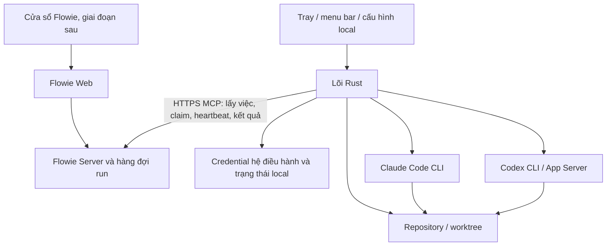
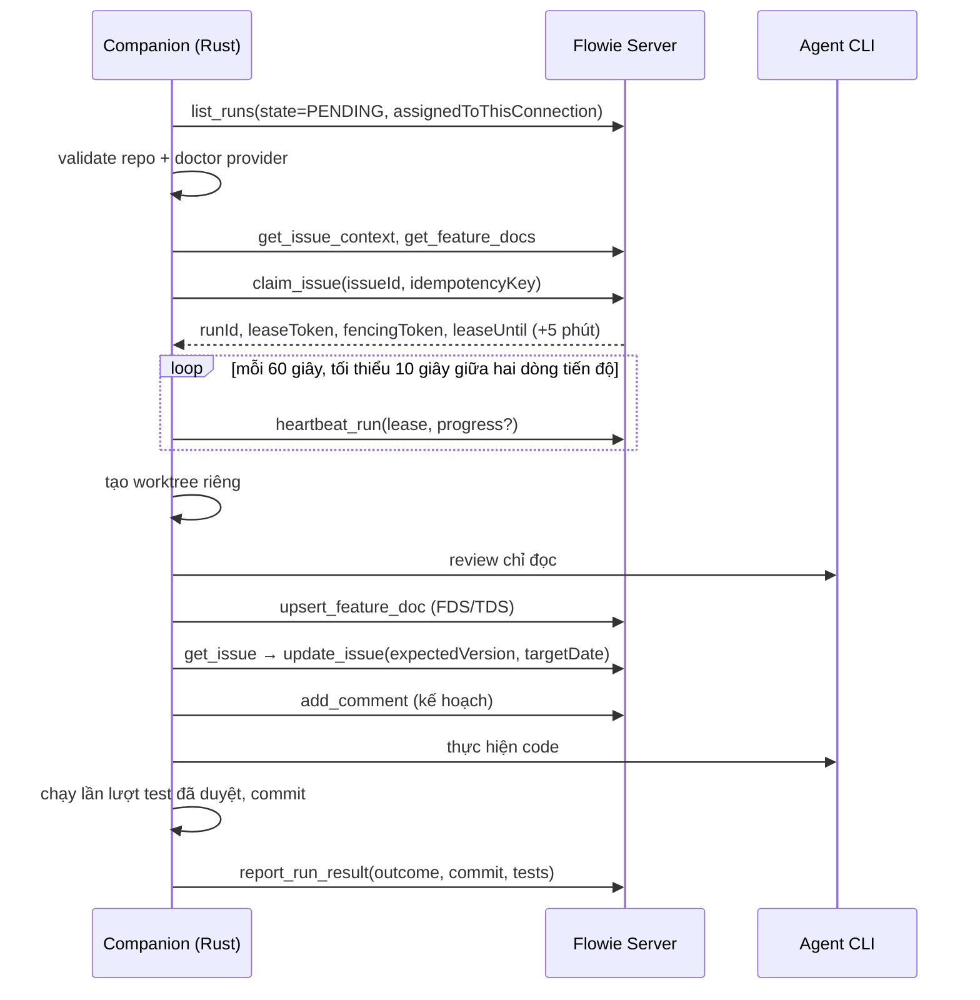

# Kế hoạch Flowie Desktop và Rust Companion

Ngày lập: 2026-11-07. Trạng thái: kế hoạch đề xuất, chưa có mã nguồn app và chưa có
FDS/TDS đồng bộ trên Flowie.

Project: **Flowie (FL)**, team **DTD**. Repository: `hoangtu0812/Flowie`, base `main`.
Task theo dõi: **DTD-487** (phần dùng chung), **DTD-488** (Windows), **DTD-489**
(macOS). Bản ADR của tài liệu này được gắn vào cả ba task trong Docs của project.

Cách đọc tài liệu: mọi phát biểu về hệ thống **hiện tại** đều dẫn `file:line` để kiểm
lại; mọi phát biểu về **tương lai** được gắn nhãn *đề xuất* hoặc *cần chốt*. Không có
câu nào mô tả tính năng chưa tồn tại như thể đã có.

## 1. Vấn đề cần giải quyết

Để một agent chạy task Flowie trên máy lập trình viên hôm nay, người dùng phải chuẩn
bị một file JSON cấu hình, đưa `FLOWIE_MCP_TOKEN` vào môi trường tiến trình cha, rồi
gọi `python -m scripts.flowie_runner --config <file> <command>` bằng tay hoặc qua một
scheduler ngoài ([Local runner](local-codex-runner.md),
`scripts/flowie_runner/__main__.py`). Hệ quả:

- **Không có trạng thái thấy được.** Người dùng không biết máy mình đang rảnh, đang
  chạy một run, hay đã mất kết nối tới Flowie.
- **Không có vòng nhận việc liên tục.** Run do automation sinh ra nằm ở `PENDING` cho
  tới khi có người chạy lệnh `pending` rồi chạy tiếp lệnh thực thi.
- **Phụ thuộc môi trường từng máy.** Python, biến môi trường, đường dẫn CLI và cấu
  hình JSON phải đúng trên mỗi máy, không có bước kiểm tra tập trung.
- **Không có cách dừng an toàn.** Hủy một lượt đang chạy chỉ có Ctrl+C ở terminal đã
  mở; đóng terminal để lại tiến trình con và worktree không xác định.

Mục tiêu của kế hoạch: một ứng dụng desktop cài một lần, tự nhận việc được giao cho
máy đó, hiện trạng thái ở tray/menu bar, cho phép tạm dừng và hủy an toàn, và về sau
mở được giao diện Flowie đầy đủ trong cùng ứng dụng.

## 2. Quyết định kiến trúc

### 2.1 Quyết định

**Một codebase, một sản phẩm Flowie Desktop cho Windows và macOS.** Bản đầu hoạt động
như companion tại system tray/menu bar; các bản sau bổ sung cửa sổ Flowie đầy đủ trên
cùng lõi ứng dụng.

Không tạo hai repository hoặc hai bộ logic nghiệp vụ riêng. Chỉ tách adapter hệ điều
hành, cấu hình đóng gói, job CI và bộ cài. Một thay đổi về nhận task, session, phân
quyền hoặc giao thức Flowie phải dùng được trên cả hai nền tảng.

| Thành phần | Lựa chọn |
| --- | --- |
| Lõi companion và điều phối công việc local | Rust |
| Vỏ ứng dụng, tray/menu bar, cửa sổ | Tauri 2, dùng Rust API cho phần native |
| Giao diện Flowie đầy đủ | Dùng giao diện web React/TypeScript hiện có |
| Runner | Chuyển các chức năng cần thiết từ Python sang Rust, kiểm chứng tương đương trước khi thay thế (§11) |
| Agent thực thi | Claude Code CLI và Codex CLI cài riêng trên máy; Codex App Server ở giai đoạn session tương tác |
| Backend, database và web server | Giữ kiến trúc Flowie hiện tại (`apps/api-python`, `apps/web`, `apps/worker`) |
| Kết nối companion → Flowie | MCP streamable HTTP, tái sử dụng tool và scope của runner hiện có (§3) |

Phạm vi “Rust hoàn toàn” áp dụng cho lõi native và runner do Flowie viết. UI web dùng
chung vẫn là React/TypeScript, và agent vẫn là tiến trình bên ngoài. Bản companion phát
hành không yêu cầu cài Python hoặc Node.js chỉ để chạy lõi Flowie; các công cụ của
repository và của provider vẫn có yêu cầu riêng của chúng.

### 2.2 Phương án đã xem xét

Ghi lại để quyết định có thể kiểm tra lại, không phải để biện hộ cho lựa chọn.

| Phương án | Được gì | Mất gì | Kết luận |
| --- | --- | --- | --- |
| **A. Bọc Python runner** — vỏ tray nhỏ (Tauri hoặc pystray) gọi `scripts/flowie_runner` qua CLI | Không port logic; dùng ngay toàn bộ hành vi đã chạy thật; tới MVP nhanh nhất | Cần Python runtime trên máy người dùng, hoặc đóng gói PyInstaller (bundle lớn, hay bị antivirus chặn, khó ký và notarize); hủy cây tiến trình, keychain, autostart vẫn phải viết native; hai lớp ngôn ngữ khi chẩn đoán lỗi | **Đường lùi hợp lệ** cho pilot nếu P0/P1 cho thấy chi phí port vượt dự kiến (§2.3) |
| **B. Electron + TypeScript** | Dùng chung ngôn ngữ với web; nhiều sẵn có cho auth/WebView | Phải viết lại runner bằng TypeScript; bundle Chromium lớn; process group và credential vẫn qua native module | Loại: chi phí port tương đương C nhưng không được lợi thế binary gọn |
| **C. Rust + Tauri (chọn)** | Một binary không cần runtime; hủy cây tiến trình, keychain, autostart bằng crate native; bundle nhỏ, ký/notarize một artifact; WebView hệ điều hành dùng lại UI web | Phải port runner và chứng minh tương đương; đội ngũ cần Rust | **Chọn** |
| **D. Rust + UI Rust (Dioxus/egui)** | Toàn bộ một ngôn ngữ | Phải viết lại toàn bộ màn hình Flowie; không tái sử dụng được web | Loại |

Lý do chọn C thay vì A: yêu cầu “không cần cài Python/Node để chạy lõi”, một artifact
ký được cho mỗi nền tảng, và quyền kiểm soát trực tiếp vòng đời tiến trình con.

### 2.3 Điều kiện đảo quyết định

- Nếu cuối **P1** mà lõi Rust chưa đạt tiêu chí tương đương ở §11, chuyển sang phương
  án A cho pilot: giữ Python runner làm lõi, vỏ Tauri gọi nó qua CLI, và ghi lại quyết
  định đó trong tài liệu này. Việc đảo phải xảy ra trước **P3** (đóng gói, ký) vì sau
  đó chi phí đổi lõi tăng mạnh.
- Nếu sau này bắt buộc UI cũng viết bằng Rust, cần một quyết định kiến trúc mới và dự
  toán viết lại giao diện. Kế hoạch này ưu tiên tái sử dụng UI web.

## 3. Hợp đồng server hiện có

Server đang chạy thật là `apps/api-python`; `apps/api` (NestJS) là mã cũ không dùng.
Mọi thay đổi server mà kế hoạch này cần đều thuộc `apps/api-python`.

### 3.1 Tool MCP và scope

Khai báo tại `apps/api-python/app/modules/mcp/registry.py`.

| Tool | Scope yêu cầu | Input chính |
| --- | --- | --- |
| `get_my_access` | — | — |
| `get_project_repositories` | `projects:read` | `projectId` |
| `get_issue_context` | `context:read` | `issueId` |
| `get_feature_docs`, `upsert_feature_doc` | `documents:read` / `documents:write` | `issueId`, Markdown đầy đủ + `changeSummary` |
| `list_runs`, `get_run` | `runs:read` + `issues:read` | `state`, `projectId`, `assignedToThisConnection`, `issueId`, phân trang |
| `claim_issue` | `runs:write` + `issues:read` | `issueId`, `idempotencyKey` |
| `heartbeat_run` | `runs:write` + `issues:read` | `runId`, `leaseToken`, `fencingToken`, `progress?` (≤300 ký tự) |
| `release_issue` | `runs:write` + `issues:read` | `runId`, `leaseToken`, `fencingToken` |
| `cancel_run` | `runs:write` + `issues:read` | `runId` |
| `report_run_result` | `runs:write` + `issues:read` + `comments:write` | `outcome`, `summary`, `commit?`, `pullRequestUrl?`, `tests[]` |
| `get_issue`, `update_issue`, `add_comment` | `issues:read` / `issues:write` / `comments:write` | `issueId`, `expectedVersion` khi ghi |

Tập scope hiện có: `activities:read`, `comments:read`, `comments:write`,
`context:read`, `documents:read`, `documents:write`, `issues:read`, `issues:write`,
`projects:read`, `reviews:read`, `runs:read`, `runs:write`.

### 3.2 Vòng đời một run

Nguồn: `apps/api-python/app/modules/agent_runs/service.py`,
`apps/api-python/app/modules/agent_runs/contracts.py`.

- **Claim.** `claim_issue` khóa issue, tìm run `PENDING`/`RUNNING` của issue đó. Nếu
  chưa có, server **tạo run ad-hoc cho connection đang gọi**; nếu có và thuộc
  connection khác → `409 "This issue is assigned to another agent connection"`
  (`service.py:168-176`). Lease hết hạn **không** mở cửa cho connection khác chiếm
  việc; muốn trả issue về chung thì phải cancel tường minh.
- **Lease 5 phút.** Claim và mỗi heartbeat đặt `lease_until = now + 5 phút`
  (`service.py:195,210,250,257`). Claim trả về `id`, `leaseToken`, `fencingToken`,
  `leaseUntil`.
- **Quyền ghi tiếp.** `heartbeat_run`, `release_issue`, `report_run_result` đòi
  `connection_id`, `fencingToken` và `leaseToken` khớp, so sánh hằng thời gian
  (`service.py:130-139`), và run phải đang `RUNNING` với lease còn hạn
  (`service.py:142-150`).
- **Budget 2 giờ.** `heartbeat_run` trả `409 "The run exceeded its two-hour budget.
  Release it before starting again."` khi `started_at < now − 2 giờ`
  (`service.py:232-238`). Đây là giới hạn cứng với mọi run, xem G1 ở §4.
- **Release.** `release_issue` đưa run về `CANCELED` và xóa lease
  (`service.py:259-275`); nó **không** trả run về `PENDING`. Sau release, cùng
  connection có thể `claim_issue` lại và server tạo một run mới.
- **Kết quả.** `report_run_result` nhận `outcome` là `AWAITING_REVIEW` hoặc `FAILED`.
  `AWAITING_REVIEW` bắt buộc có `commit`, có ít nhất một test và mọi test `passed`;
  `exitCode` phải khớp `result`; `pullRequestUrl` phải là HTTPS không chứa credential;
  `summary` 3–10000 ký tự; tối đa 50 test, mỗi log ≤4000 ký tự
  (`contracts.py:41-108`). Server không tự chuyển issue sang Done.
- **Cancel.** Qua MCP chỉ connection sở hữu được hủy (`403`, `service.py:224-230`).
  Web hủy qua REST `POST /agent-runs/runs/{id}/cancel` (`api.py:282`).
- **Hàng đợi.** `list_runs` nhận `state=PENDING`, `projectId`,
  `assignedToThisConnection=true`, `limit` (`contracts.py:104-116`); runner hiện lấy
  tối đa 100 run mỗi lượt (`__main__.py:30-42`).

### 3.3 Run được tạo từ đâu

1. **Automation theo label.** `agent_automations` lưu `connectionId`, `projectId`,
   `labelId`, `enabled`, `dailyLimit` 1–25 (`api.py:193-237`, `contracts.py:146-152`);
   dispatcher sinh run `PENDING` cho connection của rule
   (`agent_runs/dispatcher.py:56-90`).
2. **Claim trực tiếp từ agent.** `claim_issue` tạo run cho connection đang gọi (§3.2).

Không có đường thứ ba. REST của `agent_runs/api.py` chỉ có `GET /runs`,
`POST|GET|DELETE /repositories`, `POST|GET|DELETE /automations`,
`POST /runs/{id}/cancel`, `GET /summary`; `apps/web/lib/agent-runs.ts` không có hàm
tạo run. Xem G2 ở §4.

### 3.4 Cấu hình repository tin cậy

`RepositoryInput` (`contracts.py:118-144`): `projectId`, `name`, `repositoryUrl` phải
là HTTPS không credential và không fragment, `baseBranch` không bắt đầu bằng `-`,
không chứa `..` hay khoảng trắng, `testCommands` tối đa 20 mảng argument, `instructions`
≤10000 ký tự. Companion đọc cấu hình này bằng `get_project_repositories` và không được
nới lỏng các ràng buộc đó ở phía client.

### 3.5 Hành vi runner hiện tại mà companion phải giữ

Trình tự của `orchestrator.execute` (`scripts/flowie_runner/orchestrator.py:118-265`),
theo đúng thứ tự, kèm lý do:

1. `Repository.validate()` và `provider.doctor()` trước mọi lời gọi ghi.
2. `get_issue_context` + `get_feature_docs` để dựng context.
3. `claim_issue` → nhận lease; mở vòng heartbeat song song với công việc.
4. Tạo worktree riêng cho run.
5. **Review chỉ đọc trước**, sinh kế hoạch và ngày kết thúc dự kiến.
6. `upsert_feature_doc` lưu FDS/TDS **trước** comment kế hoạch, để comment ghi được
   version tài liệu và để code đi theo tài liệu.
7. `get_issue` lấy `version` rồi `update_issue` với `expectedVersion` (đọc version
   **sau** review vì mọi cập nhật issue đều tăng version; sửa đồng thời sẽ làm update
   thất bại và dừng run trước khi sửa code).
8. `add_comment` ghi kế hoạch.
9. `provider.execute` thực hiện code.
10. Chạy lần lượt các test đã duyệt; một test fail là dừng run, không được báo thành
    công.
11. Commit; publish chỉ khi được bật.
12. `heartbeat_run` mang dòng tiến độ cuối, rồi `report_run_result`.
13. `retire` worktree: dọn khi thành công, **giữ lại** khi còn việc để xem
    (`orchestrator.py:91-111`).

Các hằng số và cơ chế phải port đúng:

| Hạng mục | Giá trị hiện tại | Nguồn |
| --- | --- | --- |
| Chu kỳ heartbeat | 60 giây, tối thiểu 10 giây giữa hai lần có tiến độ | `orchestrator.py:21,119` |
| Timeout một lệnh test | `commandTimeout` 1–3600 giây, mặc định 900; quá hạn báo exit code 124 | `config.py:98-101`, `orchestrator.py:16` |
| Log tail trong kết quả | 2000 ký tự | `orchestrator.py:13` |
| Giới hạn một dòng stream | 16 MiB (sự kiện stream-JSON có thể chứa cả nội dung file) | `process.py:74` |
| Env của tiến trình con | Danh sách cho phép: `PATH`, `PATHEXT`, `SYSTEMROOT`, `WINDIR`, `COMSPEC`, `HOME`, `USERPROFILE`, `APPDATA`, `LOCALAPPDATA`, `TEMP`, `TMP`, `CODEX_HOME`, `CLAUDE_CONFIG_DIR`, `USER`, `LOGNAME`, `LANG`, `LC_ALL` | `process.py:7-29` |
| Phân giải executable | Tra PATH có PATHEXT để tới được shim `claude.CMD` trên Windows | `process.py:31+` |
| Hủy tiến trình | Windows: `taskkill` cả cây; POSIX: `killpg` SIGTERM rồi SIGKILL; con được tạo với `CREATE_NEW_PROCESS_GROUP` / `start_new_session` | `process.py:46-66,98-101` |
| Worktree root | Mặc định `<repo>.flowie-worktrees` cạnh checkout, không nằm trong checkout | `config.py:28-33` |
| Endpoint | Bắt buộc HTTPS (loopback được dùng HTTP) và kết thúc bằng `/mcp/` | `config.py:56-74` |
| Token | `FLOWIE_MCP_TOKEN` lấy từ env tiến trình cha, gửi dạng `Authorization: Bearer`, timeout HTTP 60 giây | `transport.py:28-40` |

Hai điểm về session provider: Codex hiện chạy `--ephemeral` (`codex.py:23,66`) nên lượt
đó không phải session tiếp tục được; Claude lưu `--session-id` và in lệnh
`claude --resume <id>` (`claude.py:33,75-81,121`), nhưng worktree bị dọn khi run thành
công, nên đường dẫn session có thể không còn. Xem G6 ở §4.

## 4. Khoảng trống phải xử lý

Mỗi khoảng trống gồm hiện trạng, hệ quả nếu bỏ qua, hướng xử lý *đề xuất*, và giai
đoạn phải xử lý.

**G1 — Budget 2 giờ chặn run dài.** `heartbeat_run` trả 409 khi run vượt 2 giờ
(`service.py:232-238`). Một task code thật qua agent CLI vượt 2 giờ là bình thường, nên
companion sẽ mất lease giữa đường và không thể báo kết quả. *Hướng xử lý:* chọn một
trong ba và chốt ở P0 — (a) nâng/cho cấu hình budget phía server; (b) companion tự
`release_issue` rồi `claim_issue` lại trước mốc 2 giờ, chấp nhận mỗi lần sinh một run
mới và một dòng `CANCELED` trong lịch sử; (c) giới hạn phạm vi task để không vượt 2
giờ. Phương án (b) dùng được ngay mà không sửa server, nhưng làm bẩn lịch sử run và
mất liên kết một-task-một-run. **Giai đoạn: P0 chốt, P1 hiện thực.**

**G2 — Không có đường “chạy task này trên máy tôi”.** Run chỉ sinh từ automation theo
label hoặc từ chính agent gọi `claim_issue` (§3.3). Người dùng không bấm được một nút
trên web để giao task cho một thiết bị cụ thể. *Hệ quả:* MVP companion vẫn chạy được
(nó tự chọn issue và claim), nhưng luồng “giao việc từ web cho máy X” không tồn tại.
*Hướng xử lý:* thiết kế endpoint tạo run `PENDING` có `connectionId` + `issueId` kèm
kiểm tra quyền, và một màn hình chọn thiết bị. **Giai đoạn: P1 (server), P2 (UI).**

**G3 — Server không giới hạn số run đồng thời của một connection.** Claim chỉ kiểm tra
run của issue đang claim; hai issue khác nhau cùng giao cho một connection đều claim
được. “Một lượt chạy đồng thời trên mỗi thiết bị” vì vậy là **policy phía client**.
*Hệ quả:* hai instance companion dùng cùng token sẽ mỗi bên claim một run khác nhau mà
server không chặn. *Hướng xử lý:* khóa single-instance phía app (named mutex trên
Windows, lock file/`flock` trên macOS) và giới hạn hàng đợi nội bộ; nếu cần bảo đảm
cứng thì thêm kiểm tra phía server. **Giai đoạn: P2, có điều kiện nghiệm thu riêng.**

**G4 — Không có khái niệm thiết bị.** `mcp_connections` là credential, không mang danh
tính máy, phiên bản app hay thời điểm thấy lần cuối. *Hệ quả:* tray không hiện được
“máy này là connection nào”, và admin không biết máy nào đang online. *Hướng xử lý:*
hoặc quy ước một connection cho một máy và đặt tên connection theo máy (không cần đổi
schema), hoặc thêm trường thiết bị và một heartbeat cấp connection (có migration
Prisma, xem §14). **Giai đoạn: P0 chốt phương án, P1 hiện thực.**

**G5 — Không có kênh push.** Companion phải chủ động lấy việc. *Hướng xử lý:* polling
`list_runs` với `assignedToThisConnection=true`, backoff và jitter; chu kỳ khởi điểm
*đề xuất* 10 giây khi rảnh, xác nhận lại bằng thử tải với số thiết bị dự kiến.
**Giai đoạn: P2.**

**G6 — Bàn giao session chưa có cơ sở.** Codex `--ephemeral`, và worktree của Claude bị
dọn khi thành công (§3.5). *Hướng xử lý:* chính sách lưu session/worktree tường minh
(giữ worktree khi người dùng bật “cho phép tiếp tục session”), và chỉ hiện nút tiếp tục
khi đã kiểm chứng trên máy đích. **Giai đoạn: P5.**

**G7 — `deploy-scope.sh` sẽ deploy production vì thay đổi desktop.** Script chỉ bỏ qua
`docs/*`, `*.md` và `llms.txt`; mọi path khác cho `deploy=true`
(`scripts/deploy-scope.sh`). *Hệ quả:* commit đầu tiên tạo `apps/desktop` sẽ kích hoạt
build và deploy CT107 dù không đổi gì phía server. *Hướng xử lý:* mở rộng
`deploy-scope.sh` trong **cùng commit** tạo `apps/desktop`, kèm test cho dải commit chỉ
chạm desktop. **Giai đoạn: commit đầu của P1.**

## 5. Phạm vi

### 5.1 Bản companion đầu tiên (MVP)

- Chạy trong phiên đăng nhập của người dùng, icon tray trên Windows và menu bar trên
  macOS.
- Thiết lập endpoint Flowie, connection riêng cho thiết bị, ánh xạ project/repository
  tới thư mục local, và duyệt danh sách lệnh test được phép chạy.
- Kiểm tra Git, provider CLI, đăng nhập provider và quyền truy cập repository trước khi
  nhận việc; quyền Flowie được probe theo công việc thật, không suy diễn từ việc đăng
  nhập thành công.
- Vòng nhận việc cho các run giao cho connection của máy; tạo worktree riêng, chạy
  agent, gửi tiến độ và kết quả về Flowie.
- Tạm dừng nhận việc, hủy lượt đang chạy, mở task trên web, xem chẩn đoán local.
- Mặc định một lượt chạy đồng thời trên mỗi thiết bị (policy client, xem G3); không tự
  push hay mở pull request nếu chưa bật quyền publish cho cấu hình đó.
- Khởi động cùng phiên đăng nhập là tùy chọn do người dùng bật.

Ngoài MVP: chạy khi người dùng đã đăng xuất, đánh thức máy đang ngủ, điều khiển GUI
Claude/Codex bằng tọa độ, thực thi offline, runner qua WSL/SSH, nhiều agent cùng chỉnh
một worktree, tự động merge hoặc deploy.

### 5.2 App đầy đủ

Cửa sổ desktop tải giao diện Flowie trên server đã cấu hình. Trang task, project, Docs
và settings dùng cùng nguồn giao diện với web. Phần cấu hình máy và trạng thái runner
là giao diện local riêng, vẫn mở được khi mất mạng.

“Giống web” nghĩa là cùng bố cục nội dung, component, chức năng và theme. Không cam kết
từng pixel giữa Windows và macOS do khác font, scrollbar và WebView. Khung cửa sổ và
menu native được phép khác theo hệ điều hành.

## 6. Kiến trúc và luồng chạy



Một lượt chạy, theo đúng hợp đồng ở §3:



MVP không mở HTTP listener trên máy người dùng. Deep link để mở app là cải tiến sau,
không phải điều kiện để chạy task.

## 7. Cấu trúc code và adapter theo nền tảng

Cấu trúc *đề xuất*, chưa tạo trong repository:

```text
apps/desktop/
  Cargo.toml                 # Cargo workspace của desktop
  rust-toolchain.toml        # Ghim toolchain
  crates/
    flowie-core/             # Cấu hình, state machine, điều phối và policy
    flowie-mcp/              # MCP client và contract Flowie
    flowie-agent/            # Adapter Claude/Codex, sự kiện và capability probe
    flowie-repository/       # Git, worktree và test đã duyệt
    flowie-platform/         # Credential, process, autostart theo OS
  src-tauri/                 # App Tauri, tray, cửa sổ và command giới hạn
  ui/                        # UI cấu hình local dùng web technologies
  tests/                     # Contract/integration tests và fixture
```

Đây là Cargo workspace riêng trong monorepo; pnpm tiếp tục quản lý web assets khi cần.
Ghim toolchain Rust và lockfile dependency ngay từ commit đầu. Không chọn phiên bản
crate dựa trên giả định trước khi làm thử nghiệm tương thích ở P0.

| Khía cạnh | Windows | macOS |
| --- | --- | --- |
| Giao diện nền | System tray | Menu bar, quyết định ẩn/hiện Dock theo trạng thái cửa sổ |
| Credential | Kho credential được Windows bảo vệ (chốt API cụ thể ở P0) | Keychain |
| Phân giải CLI | PATH/PATHEXT, đường dẫn có dấu và khoảng trắng, shim `.cmd` | PATH của app GUI khác terminal; cho chọn executable rõ ràng |
| Hủy tiến trình | Quản lý cả cây tiến trình; đánh giá Job Object so với `taskkill` hiện dùng | Process group, SIGTERM rồi SIGKILL khi quá hạn |
| Autostart | Theo user đăng nhập | Login item theo user đăng nhập |
| WebView | WebView2 | WKWebView |
| Bộ cài đề xuất | NSIS `.exe`; MSI chỉ khi IT yêu cầu | `.app` trong `.dmg` |
| Phát hành | Code signing | Developer ID signing và notarization |
| Build/kiểm thử | Runner Windows và máy Windows thật | Runner macOS và máy Mac thật |

Phạm vi nền tảng ban đầu *đề xuất*: Windows 11 x64 và macOS Apple Silicon. macOS Intel
có artifact riêng khi xác nhận nhu cầu và có máy kiểm thử; Windows ARM64, WSL và Linux
chưa thuộc cam kết MVP. Phiên bản macOS tối thiểu *cần chốt* sau khi đối chiếu Tauri,
provider CLI và máy thử thực tế.

Một source revision tạo nhiều artifact theo OS/CPU. Không dùng việc build Windows
thành công làm bằng chứng app chạy trên macOS. Hai nền tảng dùng cùng phiên bản ứng
dụng và cùng contract; phát hành trên nền tảng nào phải có bằng chứng của nền tảng đó.

## 8. Hợp đồng thực thi và phục hồi

- Mỗi thiết bị có connection riêng; không dùng một credential chung để nhiều máy tranh
  cùng hàng đợi (xem G4 về việc đặt tên và nhận diện).
- Server quyết định trạng thái run. UI local có trạng thái kết nối/sẵn sàng riêng;
  không thêm enum server chỉ để hiển thị tray.
- **Lease.** Heartbeat phải đi đều với chu kỳ an toàn dưới 5 phút; mặc định 60 giây như
  runner hiện tại. Hai lần heartbeat liên tiếp thất bại là mất chắc chắn về quyền sở
  hữu: **dừng trước khi tiếp tục bất kỳ hành động có side effect**.
- **Budget.** Theo dõi thời điểm `started_at`; khi gần mốc 2 giờ, xử lý theo phương án
  đã chốt ở G1 thay vì để heartbeat trả 409 giữa lúc đang sửa code.
- **Idempotency.** Mỗi mutation logic giữ nguyên `idempotencyKey` khi retry. Không tạo
  key mới chỉ vì mất response, đặc biệt ở claim, publish và report. Heartbeat dùng key
  mới cho mỗi lần theo đúng mô tả tool.
- **Fencing.** Giữ `fencingToken` của claim hiện tại; token cũ bị server từ chối, không
  tự tăng ở client.
- **Sau crash hoặc sleep.** Đối chiếu run với server (`get_run`) và với tiến trình local
  trước khi chạy tiếp. Không tự thực hiện lại task từ đầu, không claim việc giao cho
  connection khác.
- **Tạm dừng và hủy là hai hành động khác nhau.** Tạm dừng chỉ chặn claim mới; lượt hiện
  tại tiếp tục. Hủy dừng cây tiến trình rồi báo server theo contract (`release_issue`
  khi người dùng hủy, `report_run_result` với `FAILED` khi lỗi thực thi — đúng như
  runner hiện làm, `orchestrator.py:258-275`).
- **Thoát app khi đang có việc.** Cho chọn chờ hoàn tất hoặc hủy rồi thoát. Đóng cửa sổ
  cấu hình chỉ ẩn cửa sổ, app vẫn chạy ở tray.
- **Worktree.** Worktree lỗi hoặc còn dữ liệu chưa lưu phải được giữ, như hành vi hiện
  tại. Dọn chỉ khi kết quả đã được giữ an toàn và không session nào cần đường dẫn đó.
- **Journal local tối thiểu:** run ID, connection reference, provider, session ID nếu
  có, worktree, bước xử lý, trạng thái báo kết quả. Credential không nằm trong journal.
- **Giới hạn bộ nhớ.** Hàng đợi sự kiện và log có hạn mức; stream stdout/stderr theo
  dòng với giới hạn 16 MiB mỗi dòng, không đọc toàn bộ output vào RAM.
- Agent chạy được không đồng nghĩa quyền publish có hiệu lực. Lỗi Git/SCM phải được báo
  riêng và giữ commit local để xử lý tiếp.

## 9. Kết nối, credential và biên an toàn

- **Token.** MVP tái sử dụng scoped token Flowie hiện có, nhập trong màn hình cấu hình
  local và lưu qua kho credential hệ điều hành. Pairing bằng trình duyệt là hạng mục sau
  nếu server chưa có contract tương ứng. Token Flowie độc lập với phiên đăng nhập web
  và với tài khoản Claude/Codex.
- **Probe quyền theo công việc.** Kiểm tra thực tế các nhóm cần dùng: `context:read`,
  `issues:read|write`, `documents:read|write`, `comments:write`, `runs:read|write`,
  `projects:read`. Không suy diễn quyền từ việc kết nối thành công. Endpoint sai,
  credential bị thu hồi hoặc thiếu scope phải có trạng thái riêng, không gộp thành
  “offline”.
- **Gọi executable.** Dùng argument có cấu trúc; prompt đi qua stdin. Không ghép nội
  dung task, tên nhánh hay đường dẫn do server gửi thành chuỗi shell. Shim Windows cần
  adapter có kiểm thử escaping, theo hướng `resolve_executable` hiện có.
- **Môi trường tiến trình con.** Giữ nguyên nguyên tắc allowlist của `process.py:7-29`:
  tiến trình con **không kế thừa** môi trường của app; chỉ các biến trong danh sách ở
  §3.5 được truyền. Token Flowie, secret database và secret SCM không bao giờ nằm trong
  env của agent hoặc của test; dùng credential helper phù hợp cho Git.
- **Không hạ chuẩn để chạy được.** Không bật bỏ qua sandbox hoặc bỏ qua phê duyệt của
  provider nhằm đạt mục tiêu tự động. Thao tác cần tương tác thì hiển thị rõ và dừng
  theo policy.
- **Biên Tauri.** Giao diện web đầy đủ không được gọi shell, filesystem hay credential
  tùy ý. Mặc định không cấp Tauri IPC cho trang remote; chức năng native nằm trong cửa
  sổ local với command có kiểu dữ liệu, scope và kiểm tra quyền. Mọi bridge bổ sung cho
  web phải có thiết kế riêng về origin, navigation và capability. Tham chiếu:
  [capabilities](https://v2.tauri.app/security/capabilities/).

## 10. Giao diện và session

### 10.1 Menu companion

- Trạng thái: chưa cấu hình, cần đăng nhập, sẵn sàng, đang chạy, tạm dừng nhận việc,
  mất kết nối, cần xử lý lỗi.
- Mở Flowie; mở task hiện tại; cấu hình kết nối, repository và provider.
- Tạm dừng/tiếp tục nhận việc; hủy lượt hiện tại.
- Xem hoạt động và chẩn đoán; kiểm tra cập nhật; thoát.

UI cấu hình local chỉ chứa thiết lập máy và chẩn đoán, không sao chép màn hình quản lý
task/project của web. Dùng màu, font và cách diễn đạt của Flowie; kiểm tra tiếng Việt
và cả dark/light theme.

### 10.2 UI web trong app

Tải server Flowie đã xác thực qua HTTPS. Không static-export toàn bộ Next.js rồi giả
định các route cần server vẫn hoạt động. Giữ backend và Next.js server ở môi trường
hiện tại; app là client.

Kiểm thử đăng nhập thường, MFA, Microsoft SSO, callback, cookie, upload/download, mở
link ngoài, preview và clipboard trên cả WebView2 và WKWebView. Không giả định cookie
của trình duyệt hệ thống dùng được trong app. Nếu IdP không cho đăng nhập trong WebView,
cần flow đăng nhập qua trình duyệt hệ thống với callback dùng một lần có kiểm tra
`state`; không sao chép cookie bằng thủ thuật.

### 10.3 Session của provider

- MVP chạy các lượt hữu hạn qua CLI như runner hiện tại, có adapter và capability probe
  riêng cho từng provider.
- Giai đoạn tương tác bổ sung Codex App Server để start/resume/stream/approval. Đây là
  session do Flowie quản lý, không cam kết tự mở trong Codex Desktop chính thức.
- Với Claude, có thể bàn giao session đã ngừng chạy bằng
  `claude --desktop --resume <session-id>` nếu phiên bản, nền tảng và kiểu đăng nhập hỗ
  trợ; lệnh desktop không nhận prompt. Chỉ hiện nút khi đã kiểm chứng trên máy đích, và
  chỉ khi worktree của session còn được giữ (G6).
- Không dùng GUI automation và không ghi trực tiếp vào database nội bộ của ứng dụng
  provider.

## 11. Chuyển Python sang Rust: tiêu chí tương đương

Việc port chỉ được coi là xong khi chứng minh được tương đương, không phải khi code
biên dịch.

1. **Golden trace.** Chạy cùng một task fixture qua runner Python và lõi Rust trên cùng
   repository; ghi lại chuỗi lời gọi MCP (tool, thứ tự, các field của payload trừ
   `idempotencyKey` và thời gian) và so sánh. Khác biệt phải được giải thích hoặc sửa.
2. **Tương đương validation.** Các ràng buộc ở `config.py` và `contracts.py` (endpoint
   `/mcp/`, HTTPS không credential, base ref, 1–20 lệnh test, `commandTimeout` 1–3600,
   quan hệ `exitCode`↔`result`) có test đối xứng ở Rust với cùng ca hợp lệ và không hợp
   lệ.
3. **Tương đương hành vi tiến trình.** Hủy cây tiến trình, timeout 124, giới hạn dòng
   16 MiB, allowlist env — mỗi mục một test, chạy trên cả hai OS.
4. **Tương đương thất bại.** Test fail giữa lượt, commit lỗi, publish lỗi, mất mạng khi
   report: kết quả trên server phải giống hành vi hiện tại (`FAILED` kèm bằng chứng,
   hoặc `release_issue` khi người dùng hủy).
5. **Chuyển đổi có đường lùi.** Một connection không đồng thời được Python runner và
   companion nhận việc. Chuyển đổi phải dừng consumer cũ trước; quay lại Python runner
   luôn là thao tác một bước trong suốt pilot.

Python runner **không bị xóa trong MVP**. Ngừng hỗ trợ là một thay đổi riêng, sau khi
Rust đạt cả năm tiêu chí trên.

## 12. Lộ trình

Các giai đoạn là thứ tự triển khai, chưa phải cam kết ngày. Chốt effort và end date cho
từng issue sau spike, tránh ước lượng trước khi có bằng chứng trên Windows và macOS.

### 12.1 Điều kiện tiên quyết (phải xác nhận trong P0)

| Hạng mục | Vì sao chặn | Trạng thái |
| --- | --- | --- |
| Máy Mac để build và kiểm thử | Không có bằng chứng macOS thì không phát hành macOS | *cần chốt* |
| Tài khoản Apple Developer (Developer ID + notarization) | P3 không thể hoàn thành nếu thiếu | *cần chốt* |
| Chứng chỉ code signing Windows và nơi lưu khóa | Bộ cài không ký sẽ bị cảnh báo SmartScreen | *cần chốt* |
| Người sở hữu quyết định G1 (budget 2 giờ) và G4 (nhận diện thiết bị) | Hai mục này đổi thiết kế lõi | *cần chốt* |

### 12.2 Giai đoạn

| Giai đoạn | Công việc | Điều kiện hoàn thành |
| --- | --- | --- |
| **P0 — Xác minh tích hợp** | Tauri tray prototype trên hai OS; MCP Rust handshake với server thật; probe Claude/Codex; chạy fixture nhỏ; thử credential store, phân giải CLI, hủy cây tiến trình; chốt G1 và G4; xác nhận §12.1 | Có bằng chứng chạy trên Windows **và** Mac; danh sách crate kèm phiên bản; biên bản quyết định G1/G4; danh sách contract server còn thiếu (G2) |
| **P1 — Lõi Rust + contract server còn thiếu** | Config, credential adapter, MCP client, validation project/repository, worktree, claim/lease/heartbeat/fencing, journal, hủy tiến trình; mở rộng `deploy-scope.sh` (G7) trong commit đầu; endpoint tạo run theo thiết bị (G2) nếu đã duyệt | Test contract với fixture và server tích hợp; golden trace §11 đạt mục 1–3; không chạy trùng, không mất dữ liệu khi lỗi; chưa cần UI đầy đủ |
| **P2 — Companion MVP** | Onboarding local, tray/menu bar, vòng polling, adapter provider, trạng thái và tiến độ, pause/cancel, kết quả chờ review, khóa single-instance (G3) | Luồng từ run được giao tới kết quả chờ review chạy thật với cả hai provider trên hai OS; golden trace đạt mục 4; không phụ thuộc Python runner; hai instance không claim chồng |
| **P3 — Đóng gói pilot** | Bộ cài, signing và notarization, autostart opt-in, chẩn đoán, kiểm thử nâng cấp và gỡ cài đặt | Cài trên máy sạch; đăng nhập và chạy được; nâng cấp giữ cấu hình; thoát hoặc hủy không để tiến trình mồ côi |
| **P4 — Flowie Desktop đầy đủ** | Cửa sổ web dùng chung, auth/SSO, thao tác file và link, thông báo | Nghiệm thu các màn hình chính so với web; native capability không rò sang trang remote; mất mạng vẫn mở được cấu hình local |
| **P5 — Session tương tác** | Codex App Server, lưu và resume session, approval UI, Claude handoff có điều kiện | Chat/interrupt/resume qua restart theo contract provider; worktree được giữ đúng; phân biệt rõ bàn giao và phiên đang chạy |

Tự cập nhật được bổ sung sau khi có artifact đã ký, endpoint phân phối và kiểm chứng
nâng cấp. Bản pilot có thể dùng tải bộ cài thủ công. Không tự cài cập nhật trong lúc có
run; chữ ký updater và chữ ký nền tảng là hai phần quản lý riêng. Xem
[Tauri Updater](https://v2.tauri.app/plugin/updater/).

## 13. Ma trận kiểm thử

| Nhóm | Tình huống bắt buộc |
| --- | --- |
| Contract | MCP initialize và danh sách tool; envelope và lỗi; thiếu scope; connection bị thu hồi; server không hỗ trợ capability |
| Lease và quyền thực thi | Lease hết hạn; `fencingToken` cũ; `leaseToken` sai; run vượt budget 2 giờ; mất response của claim; run giao cho connection khác; project sai; origin khác; base branch không tồn tại |
| Repository | Checkout đang có thay đổi; Unicode và khoảng trắng trong đường dẫn; worktree tạo lỗi; test thất bại; commit lỗi; publish lỗi; giữ thay đổi chưa commit |
| Kết quả | `AWAITING_REVIEW` thiếu commit; thiếu test; test fail; `exitCode` không khớp `result`; PR URL không HTTPS hoặc có credential; summary quá dài; hơn 50 test |
| Provider | CLI thiếu hoặc quá cũ; chưa login; output sai schema; stderr lớn; event vượt giới hạn dòng; prompt Unicode; timeout; auth hết hạn |
| Vòng đời | Hai instance companion; tạm dừng nhận việc; hủy khi có tiến trình cháu; crash trước và sau commit; mất mạng; sleep/wake; restart khi còn run |
| Credential | Kho credential bị khóa hoặc không truy cập được; token không xuất hiện trong log, UI, export, argv hay env của agent |
| Desktop | Tray/menu đúng theo OS; menu còn phản hồi khi agent đang chạy; DPI và theme; đóng cửa sổ; autostart opt-in; gỡ cài đặt không xóa repository |
| UI đầy đủ | WebView2 và WKWebView; auth/MFA/SSO; download và upload; navigation; preview; link ngoài; chặn IPC từ origin không được phép |
| Phát hành | Bộ cài và chữ ký; cài trên máy sạch; update hợp lệ và update sai chữ ký; giữ cấu hình; tương thích với phiên bản server cũ và mới được công bố |
| CI | `deploy-scope.sh` với dải commit chỉ chạm `apps/desktop`, chỉ chạm docs, và chạm cả server |

Unit test tập trung vào state machine, retry và idempotency, validation, xử lý argument.
Integration test dùng provider giả để tái hiện lỗi xác định. Smoke test dùng CLI thật và
task fixture đã duyệt, chạy trên từng OS. Không dùng việc sinh code xong làm bằng chứng
đã chạy thành công.

## 14. Phát hành và vận hành

- Companion có pipeline build/test/artifact riêng, dùng runner Windows và macOS. Bản
  desktop chỉ phát hành sau khi nghiệm thu artifact của nền tảng tương ứng.
- **`deploy-scope.sh`.** Hiện tại mọi path ngoài `docs/*`, `*.md`, `llms.txt` đều cho
  `deploy=true`, nên commit đầu tiên tạo `apps/desktop` sẽ build và deploy CT107. Việc
  mở rộng script phải nằm trong chính commit đó, kèm test (G7). Không giả định
  desktop-only change tự được bỏ qua.
- Mọi thay đổi server cần maintainer `git pull` và rebuild trên server người dùng thật
  sự dùng. Một lần chạy workflow production xanh chỉ chứng minh build và deploy CT107,
  không chứng minh server đó đã có thay đổi.
- **Migration.** Nếu G4 (nhận diện thiết bị) hoặc G2 (tạo run theo thiết bị) cần schema
  mới, Prisma vẫn là chủ sở hữu schema: pull request và changelog phải ghi rõ rebuild
  `migrate`, `api`, `web` và chạy `migrate` trước `api`; sau deploy so số migration
  trong log `migrate` với `ls packages/database/prisma/migrations/*/migration.sql | wc -l`.
- Trước pilot, công bố phiên bản tối thiểu của server, provider CLI và app, kèm cách xử
  lý phiên bản không tương thích. Không âm thầm hạ mức kiểm tra quyền khi gặp server cũ.
- Python runner vẫn là công cụ vận hành trong giai đoạn chuyển đổi; một connection
  không đồng thời được hai consumer nhận việc (§11, mục 5).
- Với release chung của repository, tiếp tục theo quy tắc CHANGELOG, tag và deploy trong
  `AGENTS.md`. Nếu tách version/tag riêng cho desktop, phải ghi quyết định release đó
  trước khi phát hành; không dùng tag `vX.Y.Z` của server cho artifact desktop.

## 15. Rủi ro và quyết định cần chốt

| Mã | Nội dung | Ảnh hưởng | Phải chốt ở |
| --- | --- | --- | --- |
| G1 | Budget 2 giờ của `heartbeat_run` | Run dài không báo được kết quả | P0 |
| G2 | Không có endpoint tạo run cho thiết bị do người dùng chọn | Không có luồng “giao việc cho máy X” từ web | P0 quyết định, P1 hiện thực |
| G3 | Server không chặn nhiều run đồng thời của một connection | Hai instance claim chồng | P2 |
| G4 | Không có danh tính thiết bị trên `mcp_connections` | Tray và admin không nhận diện máy | P0 |
| G5 | Không có push, phải polling | Độ trễ nhận việc và tải server | P2 |
| G6 | Session bàn giao chưa có cơ sở | Nút “tiếp tục session” có thể không dùng được | P5 |
| G7 | `deploy-scope.sh` deploy production vì thay đổi desktop | Deploy ngoài ý muốn | Commit đầu P1 |
| R1 | Chi phí port Python sang Rust vượt dự kiến | Trễ toàn bộ lộ trình | Đánh giá cuối P1, đường lùi §2.3 |
| R2 | Thiếu Apple Developer ID, chứng chỉ Windows hoặc máy Mac | P3 không thể hoàn thành | P0 (§12.1) |
| R3 | IdP không cho đăng nhập trong WebView | P4 cần flow trình duyệt hệ thống | P4 |

## 16. Theo dõi trên Flowie

Công việc được theo dõi bằng một task cha cho phần dùng chung và hai subtask cho phần
phụ thuộc nền tảng, trong project **FL**, team **DTD**:

| Task | Phạm vi |
| --- | --- |
| **DTD-487** (EPIC, cha) | Lõi Rust, MCP client, port runner, vòng nhận việc, UI cấu hình local, contract server còn thiếu. Không chia theo hệ điều hành để tránh nhân đôi logic nghiệp vụ. |
| **DTD-488** | Nền tảng Windows: tray, kho credential Windows, phân giải CLI theo PATHEXT và shim `.cmd`, hủy cây tiến trình, bộ cài NSIS, code signing, WebView2. |
| **DTD-489** | Nền tảng macOS: menu bar, Keychain, PATH của app GUI, process group, `.app` trong `.dmg`, Developer ID signing và notarization, WKWebView. |

Cả ba đang ở `Todo` với due date 2027-06-30 và chưa đặt `estimatedEffort`: effort được
chốt sau P0, khi đã có bằng chứng trên cả hai hệ điều hành. Tài liệu này được gắn vào cả
ba task dưới dạng ADR trong Docs của project.

Khi bắt đầu từng task, theo quy trình của `AGENTS.md`: comment kế hoạch → end date →
In Progress → `get_feature_docs` / `upsert_feature_doc` → code → pull request. Gọi
`get_issue_context` trước khi code để xác nhận đúng repository.

Docs dự kiến: `Flowie / Desktop / Companion` và `Flowie / Desktop / Desktop UI`, mỗi
feature có FDS và TDS. Giữ các section hiện có khi cập nhật, gửi full Markdown kèm
`changeSummary`, và thêm số pull request vào changelog khi số đó tồn tại.

Bước đầu tiên là **P0 trên cả Windows và macOS**, cùng với việc chốt bốn hạng mục ở
§12.1 và hai quyết định G1, G4. Chưa cần chuyển UI hay sửa database để làm spike.

## 17. Tài liệu tham khảo

Đã đối chiếu khi lập kế hoạch; kiểm tra lại phiên bản trước khi code.

- [Tauri architecture](https://v2.tauri.app/concept/architecture/) và
  [System tray](https://v2.tauri.app/learn/system-tray/): vỏ native và tray dùng Rust.
- [Tauri WebView versions](https://v2.tauri.app/reference/webview-versions/): WebView2
  trên Windows, WKWebView trên macOS.
- [Tauri capabilities](https://v2.tauri.app/security/capabilities/): giới hạn IPC theo
  cửa sổ và origin.
- [Tauri prerequisites](https://v2.tauri.app/start/prerequisites/) và
  [Distribution](https://v2.tauri.app/distribute/): môi trường build và đóng gói.
- [Tauri Updater](https://v2.tauri.app/plugin/updater/): tự cập nhật và chữ ký.
- [Claude CLI reference](https://code.claude.com/docs/en/cli-reference) và
  [Desktop](https://code.claude.com/docs/en/desktop): giới hạn mở và bàn giao session.
- [Codex App Server](https://learn.chatgpt.com/docs/app-server): thread, turn, sự kiện
  và tiếp tục phiên.
- [Local Flowie runner](local-codex-runner.md): cấu hình và hành vi vận hành hiện có.
- Mã nguồn đối chiếu: `scripts/flowie_runner/`,
  `apps/api-python/app/modules/agent_runs/`, `apps/api-python/app/modules/mcp/registry.py`,
  `scripts/deploy-scope.sh`.
