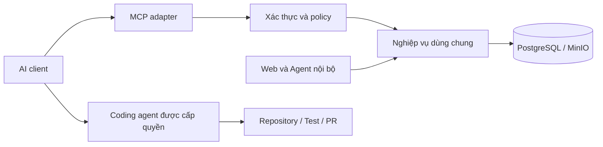

# Flowie — Kế hoạch triển khai MCP và tích hợp AI xử lý công việc

> Cập nhật trạng thái 2026-10-15: code của kế hoạch này đã merge và workflow CT107 đã thành công. Các checkpoint và bảng IN_REVIEW bên dưới giữ lịch sử phát triển; xem [bằng chứng hiện hành](release-evidence-2026-10-15.md). Nghiệm thu AI thật, mailbox và off-host backup vẫn được theo dõi riêng, không tự chuyển DONE.

- Ngày lập: 2026-10-14, múi giờ Asia/Saigon (+07).
- Trạng thái code: đã merge PR 1 và triển khai qua workflow `38524564916`; nghiệm thu client/AI thật còn điều kiện ngoài hệ thống.
- Người dùng đã cho phép đẩy nhánh tính năng lên `https://github.com/hoangtu0812/Flowie.git`; commit `2609379` đã được đẩy và [CI](https://github.com/hoangtu0812/Flowie/actions/runs/38522306016) hoàn tất thành công. Sau checkpoint này, PR 1 đã merge và workflow production thành công; không dùng CI nhánh cũ làm bằng chứng cho các thay đổi đợt mới.
- Client mục tiêu đã chốt: Codex/Cursor/Claude chạy trên máy nội bộ, dùng token giới hạn quyền. SDK tham chiếu đã kiểm thử; cấu hình mẫu không thay thế nghiệm thu từng client thực tế.
- Mục tiêu quản lý: theo dõi phạm vi, phụ thuộc, tiến độ, tiêu chí nghiệm thu và bằng chứng bàn giao.
- Phạm vi tài liệu: MCP và các cải tiến trực tiếp phục vụ AI kết nối Flowie. Không thay thế kế hoạch của các phân hệ khác.
- Quy tắc có hiệu lực: [AGENTS.md](../AGENTS.md) và [quy trình phát hành](release-process.md). Prisma tiếp tục sở hữu schema; CT107 là môi trường triển khai duy nhất.


## Checkpoint triển khai — 2026-10-14

- Đã xây MCP bằng SDK Python chính thức 2.3.0, mount cùng FastAPI tại `/mcp/`, hỗ trợ scoped token và hai phiên bản protocol được kiểm thử: `2025-11-25`, `2026-07-28`.
- Đã tách `core`, `access`, `work_items`, `notifications`, `mcp`, `agent_runs`; controller cũ giữ facade tương thích. Service dùng chung không gọi HTTP controller.
- Đã có đọc/ghi issue, template bug, comment, tài liệu theo project/issue, revision/diff/restore, context có giới hạn và đọc attachment UTF-8 có kiểm tra quyền trước storage.
- Đã có grant giới hạn team/project, version triggers cho mọi writer, idempotency nguyên tử, audit, quota, retention và notification outbox.
- Đã có cấu hình repository, run lease/heartbeat/fencing/cancel/report, queue theo project + label, giới hạn lượt chạy và thống kê. API không thực thi lệnh repository hoặc tự mở PR.
- Đã có màn hình quản lý trong Settings → Integrations và reference CLI trong `scripts/mcp-client.py`.
- Đã thêm verification workflow; production workflow yêu cầu job verification thành công trước khi deploy.
- Tài liệu kỹ thuật: [kiến trúc module](mcp-architecture.md), [runbook](mcp-runbook.md).
- Bằng chứng local: 86 test đạt, 2 test tích hợp cũ không chạy vì chưa cấu hình, 10 subtest đạt; toàn bộ 79 migration chạy trên database mới và test nâng cấp kiểm tra tài liệu cũ/revision; TypeScript và web production build đạt; UI browser không có lỗi console.
- Bằng chứng GitHub: workflow `38522306016`, đúng SHA `26093793ef77df24041b548b2d27d288dcd7b29d`, kết quả `success`; clean migration, backend/MCP tests, web build và Compose đều đạt trên runner Ubuntu.
- Schema diff không có sai lệch ở các bảng/cột MCP mới. Có sai lệch sẵn có ở index `users_last_seen_at_idx` và default `updated_at` của một số bảng legacy; cần quản lý riêng, không tự đổi production schema.

Các mục DONE bên dưới là trạng thái phát triển đã có kiểm thử cục bộ. Bằng chứng production thuộc MCP-20 và không được suy ra từ build/test local. Các mục IN_REVIEW còn tiêu chí cần xác minh hoặc cải tiến, được liệt kê cuối checkpoint.

Các phụ thuộc triển khai trong bảng không ngăn chuẩn bị và kiểm thử code P2 trước khi rollout M3.

Phần còn lại để hoàn tất toàn bộ kế hoạch:

1. MCP-06: OAuth hoãn ngoài phạm vi client nội bộ đã chọn; chỉ triển khai khi bổ sung client cần flow OAuth. Bản hiện tại dùng scoped-token authentication.
2. MCP-17/19: kiểm thử client desktop thực tế và cấu hình tương ứng; reference SDK và UI cục bộ đã kiểm tra.
3. MCP-18: quota tổng workspace/tool và dashboard đã bổ sung trong PR 3, đã merge. Operations/audit nâng cao của đợt mới vẫn ở nhánh product-completeness, chưa deploy.
4. MCP-20: code đã merge và workflow production đúng merge SHA success. Nghiệm thu client thực tế và các điều kiện ngoài hệ thống vẫn cần bằng chứng riêng.
5. MCP-22/23: đã chọn Codex, repository và bug GEN-9 synthetic để chạy CLI thật. Run FAILED vì CLI hiệu lực read-only; không có diff/commit/PR. Chờ môi trường cho phép ghi và nghiệm thu CT107; xem tracker đợt product-completeness.
6. MCP-24/25: kiểm thử restart/hủy/retry hết lượt trong triển khai thực tế; đo baseline vận hành trước/sau tối ưu và chi phí nếu provider hỗ trợ.

## 1. Mục tiêu và kết quả mong đợi

AI được cấp quyền có thể chọn dự án, tìm task/bug, đọc đủ ngữ cảnh, phân tích, viết tài liệu, bình luận và cập nhật công việc qua MCP. Giai đoạn mở rộng cho phép kết nối coding agent để sửa mã, chạy kiểm thử, tạo PR và báo cáo kết quả về Flowie.

Các luồng nghiệm thu chính:

1. “Liệt kê bug chưa hoàn tất của dự án A, ưu tiên lỗi nghiêm trọng và quá hạn.”
2. “Đọc task FLOW-123 cùng bình luận, tài liệu, phụ thuộc và PR liên quan; đề xuất cách xử lý.”
3. “Ghi phân tích vào tài liệu dự án, thêm comment vào task và chuyển trạng thái được phép.”
4. “Nhận xử lý bug, sửa mã trong repository được cấp quyền, chạy test và tạo PR để review.”
5. “Tổng hợp kết quả, liên kết PR và chuyển trạng thái theo bằng chứng thực tế.”

MCP cung cấp giao diện công cụ và dữ liệu cho AI. Khả năng sửa mã, chạy lệnh và tạo PR thuộc coding agent/môi trường thực thi; không mặc nhiên có khi MCP server được triển khai.

## 2. Hiện trạng đã kiểm tra

Đây là kết quả đọc mã nguồn ngày lập kế hoạch, chưa phải bằng chứng kiểm thử production.

| Thành phần | Hiện trạng | Hướng xử lý |
| --- | --- | --- |
| Backend | FastAPI trong `apps/api-python` phục vụ ứng dụng; NestJS là tham chiếu chuyển đổi | Xây MCP trên backend Python và nghiệp vụ dùng chung |
| Issue | Có CRUD, trạng thái, assignee, priority, project, label, quan hệ, sub-issue | Bổ sung truy vấn và contract phù hợp AI |
| API key | Có tạo/thu hồi `flowie_pat_*`; `current_user()` hiện chỉ đọc cookie `flowie_access` | Hoàn thiện xác thực token; bổ sung phạm vi quyền |
| Danh sách issue | Có workspace/team/category/scope; chưa có lọc `projectId`, tìm kiếm và phân trang ở API danh sách đã kiểm tra | Bổ sung lọc ở server và giới hạn dữ liệu |
| Comment | Có đọc/tạo/sửa/xóa; tạo comment có activity và notification | Dùng lại nghiệp vụ, thêm định danh kết nối và chống tạo trùng |
| Document | Có nội dung, workspace/team/folder; chưa có liên kết project trực tiếp trong model | Bổ sung đọc chi tiết, liên kết, revision và kiểm tra quyền |
| Quyền đọc document | Bỏ `teamId` dẫn tới truy vấn trong workspace mà chưa lọc quyền từng team | Xác định tài liệu dùng chung và tài liệu của team; lọc tại server |
| Task/bug | Model Issue chưa có trường loại issue và dữ liệu tái hiện bug chuyên biệt | MVP dùng label/template; schema mở rộng sau quyết định nghiệp vụ |
| Cập nhật đồng thời | Chưa thấy version precondition trong cập nhật issue/document đã kiểm tra | Bổ sung kiểm tra phiên bản nguyên tử |
| Agent nội bộ | Có lập kế hoạch, thống kê và các thao tác hỗ trợ dự án | Tái sử dụng service, giữ quy tắc chấp nhận kế hoạch hiện có |
| SCM | GitHub/Azure DevOps phục vụ đồng bộ review và liên kết issue, chủ yếu chỉ đọc | Đọc lại quyền và bổ sung đường thực thi riêng khi cần tạo PR |
| MCP | Có tên tích hợp trên UI; chưa thấy server MCP trong backend | Triển khai và kiểm thử kết nối thực tế |

Nguồn đối chiếu:

- [Khởi tạo FastAPI](../apps/api-python/app/main.py), [xác thực](../apps/api-python/app/domains/auth.py).
- [Issue](../apps/api-python/app/domains/native_issues.py), [project](../apps/api-python/app/domains/native_projects.py), [comment](../apps/api-python/app/domains/native_comments.py).
- [Document](../apps/api-python/app/domains/native_documents.py), [schema Prisma](../packages/database/prisma/schema.prisma).
- [Agent](../apps/api-python/app/domains/agent.py), [hướng dẫn Agent](agent-setup.md), [tích hợp SCM](reviews-integrations.md).

## 3. Phạm vi và nguyên tắc thiết kế

### 3.1. Phân chia sản phẩm bàn giao

| Mốc | Phạm vi | Điều kiện hoàn thành |
| --- | --- | --- |
| M0 — Thiết kế | Client mục tiêu, contract, quyền, kiến trúc, dữ liệu | Các quyết định ảnh hưởng triển khai được ghi nhận |
| M1 — Đọc | Kết nối MCP, xác thực, project/issue/comment/document/context | AI đọc đúng phạm vi bằng client thật; không có công cụ ghi được bật |
| M2 — Ghi | Tạo/sửa task, comment, tài liệu, chuyển trạng thái | Có audit, chống trùng và xử lý xung đột; quyền ghi được thực thi |
| M3 — Vận hành MVP | Quản lý kết nối, giám sát, hướng dẫn, triển khai | Có bằng chứng CI, migration, readiness và smoke test trên CT107 |
| M4 — Thực thi code | Agent run, nhận việc, repository, test, PR | Một bug đi trọn luồng từ nhận việc đến PR và kết quả kiểm thử |
| M5 — Tự động hóa | Sự kiện, hàng đợi, retry, ngân sách và tổng hợp | Sự kiện trùng không sinh công việc trùng; có hủy và phục hồi |

MVP chức năng gồm M1–M2; MVP sẵn sàng vận hành gồm M0–M3. M4–M5 là phần mở rộng, không phải điều kiện để AI đọc/ghi Flowie.

### 3.2. Kiến trúc đề xuất



- Ưu tiên adapter Python cạnh FastAPI; quyết định mount chung hay process riêng tại MCP-01 sau khi kiểm tra SDK và vòng đời server.
- Tách nghiệp vụ cần dùng khỏi HTTP route theo từng lát; không sao chép SQL và quy tắc quyền sang một backend độc lập.
- Mỗi thao tác nhận một principal có người dùng, kết nối, scope và giới hạn workspace/team/project. Quyền hiệu lực là giao của tất cả các giới hạn đó.
- Không cung cấp công cụ SQL tùy ý, HTTP tùy ý hoặc shell trên máy production trong MCP quản lý công việc.
- Dùng Streamable HTTP cho remote; hỗ trợ stdio nếu client nội bộ có nhu cầu được xác nhận.
- Phiên bản MCP/SDK phải được khóa và kiểm thử với client mục tiêu; không dùng tên “MCP” trên UI làm bằng chứng tương thích.
- Ghi dữ liệu qua cùng service để duy trì transaction, notification, activity và invariant hiện có.
- Tài liệu/task/comment là dữ liệu tham khảo, không có quyền mở rộng scope hoặc thay đổi policy của agent.

## 4. Cách cập nhật tiến độ

Trạng thái công việc: `TODO`, `IN_PROGRESS`, `BLOCKED`, `IN_REVIEW`, `DONE`.

- Chỉ chuyển `DONE` khi đạt tiêu chí nghiệm thu và có bằng chứng. “Có code” hoặc “có màn hình” chưa đủ.
- Mỗi ID bên dưới tương ứng một đầu việc quản lý; có thể chia thành task con khi giao thực hiện.
- Khi bắt đầu: điền người phụ trách, ngày bắt đầu, trạng thái và phụ thuộc còn thiếu.
- Khi bị chặn: ghi nguyên nhân, người cần xử lý và hành động tiếp theo vào nhật ký.
- Khi bàn giao: ghi PR/commit, kiểm thử đã chạy và kết quả. Chỉ ghi triển khai thành công khi đã xác minh đúng commit.
- Giữ trạng thái triển khai riêng với trạng thái phát triển. Task hoàn tất cục bộ không đồng nghĩa đã lên CT107.
- Ưu tiên P0: nền tảng bắt buộc; P1: chức năng MVP; P2: mở rộng. Thứ tự thực hiện còn phụ thuộc cột phụ thuộc.

### 4.1. Bảng quản lý tổng

| ID | Hạng mục | Mốc | Ưu tiên | Phụ thuộc | Trạng thái | Phụ trách | Bằng chứng |
| --- | --- | --- | --- | --- | --- | --- | --- |
| MCP-01 | Chốt client, giao thức và kiến trúc | M0 | P0 | — | DONE | Codex / cần người nghiệm thu | SDK 2.3.0; HTTP legacy/modern tests |
| MCP-02 | Chốt quyền và chính sách thao tác | M0 | P0 | 01 | DONE | Codex / cần người nghiệm thu | Scope + binding policy; read/write dependency checks |
| MCP-03 | Service dùng chung và contract | M0 | P0 | 01, 02 | DONE | Codex / cần người nghiệm thu | modules/access + work_items + db/mutations |
| MCP-04 | Schema và chiến lược migration | M0 | P0 | 02, 03 | DONE | Codex / cần người nghiệm thu | Hai migration; clean DB + upgrade/backfill + schema diff |
| MCP-05 | Xác thực token và vòng đời kết nối | M1 | P0 | 02, 04 | DONE | Codex / cần người nghiệm thu | Token expiry/revoke; cookie isolation tests |
| MCP-06 | OAuth cho remote client mục tiêu | M1 | P0 | 01, 05 | TODO | Codex / cần người nghiệm thu | OAuth chưa triển khai |
| MCP-07 | Policy và sửa phạm vi đọc dữ liệu | M1 | P0 | 02, 03, 05 | DONE | Codex / cần người nghiệm thu | Cross-project/team/workspace + membership tests |
| MCP-08 | MCP server và tool registry | M1 | P0 | 01, 03, 05 | DONE | Codex / cần người nghiệm thu | Official SDK HTTP round trips; bounded schemas |
| MCP-09 | Search, filter và pagination | M1 | P0 | 03, 07 | DONE | Codex / cần người nghiệm thu | 1.000 issue; cursor/filter tests |
| MCP-10 | Bộ công cụ đọc và gói ngữ cảnh | M1 | P1 | 08, 09 | DONE | Codex / cần người nghiệm thu | Context, UTF-8 attachment, bug template |
| MCP-11 | Audit và định danh AI | M2 | P0 | 04, 05, 07 | DONE | Codex / cần người nghiệm thu | Audit + correlation + deny/failure logging |
| MCP-12 | Idempotency và concurrency | M2 | P0 | 03, 04, 11 | DONE | Codex / cần người nghiệm thu | Concurrent retry + stale version + key budget tests |
| MCP-13 | Tạo/sửa issue và chuẩn hóa bug | M2 | P1 | 10, 12 | DONE | Codex / cần người nghiệm thu | Create/update + bug label/template contract |
| MCP-14 | Workflow và chuyển trạng thái | M2 | P1 | 02, 12, 13 | DONE | Codex / cần người nghiệm thu | Dedicated transition + reason + scope checks |
| MCP-15 | Công cụ bình luận | M2 | P1 | 10, 12 | DONE | Codex / cần người nghiệm thu | Comment create/update/retry/version tests |
| MCP-16 | Tài liệu, liên kết và revision | M2 | P1 | 04, 10, 12 | DONE | Codex / cần người nghiệm thu | Links + revision/diff/restore + read pages |
| MCP-17 | UI quản lý kết nối và quyền | M3 | P1 | 05, 07, 08, 11 | IN_REVIEW | Codex / cần người nghiệm thu | UI build + browser smoke; desktop client còn chờ |
| MCP-18 | Giới hạn, quan sát và phục hồi | M3 | P0 | 08, 11, 12 | IN_REVIEW | Codex / cần người nghiệm thu | Outbox/quota/retention/logs; aggregate limits còn chờ |
| MCP-19 | Kiểm thử tích hợp và client | M3 | P0 | 06–18 | IN_REVIEW | Codex / cần người nghiệm thu | Local suite + web build; CI/client thực tế còn chờ |
| MCP-20 | Runbook và triển khai MVP | M3 | P0 | 19 | TODO | Codex / cần người nghiệm thu | Chưa triển khai CT107 |
| MCP-21 | Agent run và nhận việc có thời hạn | M4 | P2 | 12, 14, 20 | DONE | Codex / cần người nghiệm thu | Lease/reclaim/fencing/heartbeat/report tests |
| MCP-22 | Repository mapping và runner | M4 | P2 | 21 | IN_REVIEW | Codex / cần người nghiệm thu | Repository config + read tools; external execution còn chờ |
| MCP-23 | PR, CI và bằng chứng hoàn thành | M4 | P2 | 22 | TODO | Codex / cần người nghiệm thu | Chưa tạo PR thật hoặc xác minh CI provider |
| MCP-24 | Hàng đợi và trigger theo sự kiện | M5 | P2 | 18, 21, 23 | IN_REVIEW | Codex / cần người nghiệm thu | Durable event queue + deduplication; operational tests còn chờ |
| MCP-25 | Báo cáo và tối ưu vận hành AI | M5 | P2 | 24 | IN_REVIEW | Codex / cần người nghiệm thu | Run summary UI/API; baseline/cost/optimization còn chờ |

Số trong cột phụ thuộc là phần số của ID MCP. Kiểm thử được viết cùng từng đầu việc; MCP-19 là cổng kiểm thử xuyên suốt, không phải thời điểm bắt đầu viết test. MCP-06 có thể được dời khỏi M1 chỉ khi MCP-01 ghi rõ MVP giới hạn ở client đã kiểm chứng hỗ trợ token nội bộ; không được quảng bá là hỗ trợ OAuth khi chưa hoàn thành.

## 5. Công việc chi tiết và tiêu chí nghiệm thu

### M0 — Thiết kế và chuẩn bị

**MCP-01 — Client, giao thức và kiến trúc**

- [x] Lập ma trận client mục tiêu, phiên bản, transport, cơ chế auth và đường mạng từ client đến CT107.
- [x] Chọn SDK Python, khóa phiên bản và kiểm tra khả năng tích hợp FastAPI/lifespan/proxy.
- [x] Chốt endpoint, cấu hình bật/tắt, cấu trúc module và chế độ chạy.
- Nghiệm thu: có quyết định kiến trúc và kịch bản kết nối cho từng client trong phạm vi; chưa gán trạng thái “hỗ trợ” cho client chưa thử.

**MCP-02 — Quyền và chính sách thao tác**

- [x] Định nghĩa scope đọc/ghi riêng cho project, issue, comment, document và review.
- [x] Định nghĩa phạm vi workspace/team/project, quyền với issue không có project và tài liệu dùng chung.
- [x] Chốt chính sách tự động/duyệt cho từng nhóm thao tác; cấp quyền trước có thể cho phép ghi mà không hỏi lại từng lần.
- [x] Phân biệt người dùng ủy quyền, kết nối AI và tài khoản dịch vụ nếu thực sự cần.
- Nghiệm thu: có ma trận allow/deny; thay ID trong tham số không thể vượt quyền; dữ liệu task/comment không thể tự cấp quyền.

**MCP-03 — Service dùng chung và contract**

- [x] Tách các thao tác được MCP sử dụng khỏi route theo từng domain, giữ hành vi Web hiện hữu.
- [x] Chuẩn hóa schema đầu vào/đầu ra, ID, mã issue, trường nullable, ngày giờ và lỗi.
- [x] Xác định chủ sở hữu transaction; tránh một service commit giữa chừng trong thao tác cần nguyên tử.
- Nghiệm thu: route Web và MCP dùng cùng invariant, policy và nghiệp vụ; kiểm thử hồi quy các luồng bị ảnh hưởng đạt.

**MCP-04 — Schema và migration**

- [x] Thiết kế lưu kết nối/grant, scope, resource binding, idempotency, audit và version.
- [x] Chốt liên kết document–project/issue và revision; hoãn schema agent run đến M4 nếu chưa cần.
- [x] Thiết kế backfill/default, index và khả năng chạy tương thích với phiên bản ứng dụng trước.
- Nghiệm thu: migration Prisma đã commit được thử trên database mới và bản dữ liệu kiểm thử tương đương schema hiện tại; có kế hoạch phục hồi dữ liệu.

### M1 — Đọc dữ liệu qua MCP

**MCP-05 — Xác thực token và kết nối**

- [x] Hoàn thiện kiểm tra Bearer token, hash, hạn dùng, thu hồi, tài khoản và quyền hiện tại.
- [x] Lưu grant/phạm vi kết nối, cập nhật lần sử dụng; không trả lại token đầy đủ sau lần cấp ban đầu.
- [x] Giữ cookie auth của Web hoạt động; xác định riêng quyền quản lý credential.
- Nghiệm thu: token hợp lệ dùng được; token hết hạn/thu hồi, user bị khóa hoặc mất membership bị từ chối; không ghi secret vào log.

**MCP-06 — OAuth remote**

- [ ] Chọn authorization server phù hợp, thiết lập metadata discovery, flow ủy quyền và PKCE cho client tương ứng.
- [ ] Kiểm tra audience/resource, issuer, scope, redirect URI và vòng đời access/refresh token.
- [ ] Gắn consent với grant Flowie; không truyền token nhận từ client sang provider khác như token dùng chung.
- Nghiệm thu: client mục tiêu đăng nhập, cấp quyền, gọi công cụ và mất quyền sau thu hồi; có kết quả kiểm thử từng client.

**MCP-07 — Policy và phạm vi dữ liệu**

- [x] Áp dụng cùng policy cho list, detail, search, context, attachment, review và mutation.
- [x] Sửa đường đọc document khi không có `teamId`; chỉ trả tài liệu dùng chung hợp lệ và tài liệu team được truy cập.
- [x] Kiểm tra object liên quan trước khi trả title/snippet/count/URL; key có project binding không đọc được dữ liệu ngoài binding.
- Nghiệm thu: bộ test chéo workspace/team/project và mất membership đạt, bao gồm dữ liệu lồng trong context và kết quả search.

**MCP-08 — Server và registry**

- [x] Triển khai transport, tool discovery, schema validation và kết quả có cấu trúc bằng SDK đã chọn.
- [x] Registry chỉ công bố công cụ được bật và phù hợp quyền; mỗi lần gọi vẫn kiểm tra quyền lại.
- [x] Đặt timeout, giới hạn payload/kết quả; cấu hình HTTPS/proxy và kiểm tra Origin theo transport triển khai.
- Nghiệm thu: client thật khám phá/gọi được công cụ; input sai trả lỗi rõ; không có công cụ ghi khả dụng khi chế độ chỉ đọc bật.

**MCP-09 — Truy vấn và phân trang**

- [x] Thêm lọc server: `projectId`, team, status/category, assignee, priority, label, khoảng ngày và từ khóa.
- [x] Thêm cursor và thứ tự ổn định với ID làm tiêu chí phân định; có giới hạn số bản ghi.
- [x] Trả summary cho list, tải detail theo nhu cầu; giảm truy vấn từng issue trong vòng lặp.
- [x] Tra cứu mã issue có giới hạn workspace; đo query plan và bổ sung index dựa trên truy vấn thực tế.
- Nghiệm thu: bộ dữ liệu kiểm thử trên 1.000 issue trả đúng filter, phân trang không trùng trên snapshot ổn định, không trả toàn workspace để client tự lọc.

**MCP-10 — Công cụ đọc và ngữ cảnh**

- [x] Cung cấp bộ công cụ đọc trong mục 6, gồm danh mục trạng thái/nhãn/thành viên hợp lệ.
- [x] `get_issue_context` tổng hợp mô tả, comment, quan hệ, tài liệu, attachment metadata và review liên quan.
- [x] Có giới hạn từng phần, dấu hiệu bị cắt và cursor; nội dung file chỉ được đọc theo quyền và loại file được hỗ trợ.
- Nghiệm thu: thực hiện được luồng 1–2 ở mục 1 bằng client thật, có nguồn/ID để truy ngược và không lộ object ngoài quyền.

### M2 — Ghi dữ liệu và cộng tác

**MCP-11 — Audit và danh tính AI**

- [x] Ghi actor, connection/client, run/correlation ID, tool, entity, thời gian và kết quả.
- [x] Ghi thay đổi trước/sau ở mức cần thiết, có che dữ liệu nhạy cảm; không lưu toàn prompt/token mặc định.
- [x] Kết hợp activity cho người dùng với audit phục vụ vận hành; ghi nhận cả lỗi và từ chối quyền ở mức phù hợp.
- Nghiệm thu: từ một comment hoặc cập nhật AI có thể xác định người ủy quyền và lần gọi; audit của thao tác thành công gắn nhất quán với mutation.

**MCP-12 — Chống trùng và chống ghi đè**

- [x] Yêu cầu idempotency key cho tạo issue/comment/document và thao tác ghi cần retry an toàn.
- [x] Khóa uniqueness theo principal/connection, tool và key; lưu hash payload cùng kết quả trong cơ chế nguyên tử.
- [x] Cùng key khác payload trả conflict; quy định retention và hành vi sau khi hết thời gian lưu.
- [x] Thêm version precondition cho update; kiểm tra và update nguyên tử, không dùng check-then-write tách rời.
- Nghiệm thu: hai request đồng thời cùng key chỉ tạo một kết quả; mất response rồi retry không tạo trùng; dữ liệu đã đổi trả conflict và hướng dẫn tải lại.

**MCP-13 — Issue và bug**

- [x] Tạo/sửa issue, liên kết project, assignee, nhãn, priority, hạn và sub-issue theo contract.
- [x] MVP chuẩn hóa nhãn/template bug: bước tái hiện, thực tế, mong đợi, môi trường, phiên bản, log và tiêu chí nghiệm thu.
- [x] Ghi quyết định khi nào cần `type`/`severity` có cấu trúc; không ép chuyển đổi toàn bộ issue cũ trong MVP.
- Nghiệm thu: AI tạo/sửa task và bug, dữ liệu còn sau refresh/restart, tham chiếu không hợp lệ hoặc ngoài quyền bị từ chối.

**MCP-14 — Workflow**

- [x] Cung cấp thao tác chuyển trạng thái riêng, đọc trạng thái hợp lệ theo team thay vì hardcode tên.
- [x] Áp dụng policy cả khi cập nhật `statusId` qua đường update chung để tránh bypass.
- [x] Ghi lý do/bằng chứng nếu workflow yêu cầu; phân biệt đang làm, chờ review, bị chặn và hoàn tất theo cấu hình thực tế.
- Nghiệm thu: transition trái policy bị từ chối; trường thời gian hoàn tất/hủy và activity/notification nhất quán; tạo PR không tự được coi là xong.

**MCP-15 — Bình luận**

- [x] Hỗ trợ text/Markdown theo khả năng renderer hiện có; giữ nội dung và rich-text body nhất quán.
- [x] Cho phép thêm và sửa theo quyền tác giả/ủy quyền đã chốt; không mặc định cho AI sửa comment người khác.
- [x] Tái sử dụng activity/notification; retry không tạo comment hay thông báo trùng.
- Nghiệm thu: comment có tác giả và nguồn thao tác rõ, hiển thị đúng trên Web và chỉ người có quyền mới chỉnh sửa được.

**MCP-16 — Tài liệu**

- [x] Bổ sung get-by-ID, search và liên kết tài liệu với project/issue, hỗ trợ nhiều liên kết khi nghiệp vụ cần.
- [x] Tạo/sửa Markdown; nếu có cập nhật từng phần phải định nghĩa anchor/version rõ để không sửa nhầm đoạn.
- [x] Lưu revision, xem diff và phục hồi bằng revision mới; kiểm tra quyền cả tài liệu lẫn đối tượng được liên kết.
- Nghiệm thu: AI viết tài liệu cho đúng dự án; xung đột không mất nội dung người dùng; truy ngược và phục hồi được bản trước.

### M3 — Quản lý và triển khai MVP

**MCP-17 — Màn hình quản lý**

- [ ] Trang kết nối AI cho phép cấp/thu hồi quyền, chọn phạm vi và xem lần dùng gần nhất.
- [ ] Quản lý danh sách tool được bật và policy thao tác; không hiển thị kết nối chưa hoạt động như đã cài đặt.
- [ ] Xem audit/lỗi đã che secret; cung cấp cấu hình kết nối mẫu theo client đã thử.
- Nghiệm thu: người dùng đủ quyền tự thiết lập và thu hồi kết nối; thành viên thường không thay chính sách của quản trị viên.

**MCP-18 — Giới hạn và quan sát**

- [ ] Rate limit theo kết nối/workspace, timeout và hạn mức kết quả; phản hồi cho phép client retry có kiểm soát.
- [ ] Theo dõi lượt gọi, lỗi auth/policy, độ trễ, conflict, retry và lỗi notification.
- [ ] Thiết kế bảo đảm phát sự kiện sau commit, ưu tiên outbox cho thông báo cần retry bền vững.
- [ ] Có kill switch cho MCP và riêng công cụ ghi; quy định retention audit, idempotency và log.
- Nghiệm thu: request quá hạn/quá mức được xử lý rõ; tắt công cụ ghi có hiệu lực; lỗi gửi notification không làm client tạo mutation trùng.

**MCP-19 — Kiểm thử xuyên suốt**

- [ ] Hoàn thành ma trận kiểm thử mục 8 và các test hồi quy Web/Agent bị ảnh hưởng.
- [ ] Kiểm tra contract/transport/auth với từng client mục tiêu; test list-tools và gọi tool không thay thế nhau.
- [ ] Chạy build và cấu hình Compose sản xuất; kiểm tra migration dependency và biến môi trường bắt buộc.
- Nghiệm thu: ghi lệnh, kết quả, phiên bản client/SDK và lỗi còn tồn tại; không có lỗi chặn bảo mật, tính toàn vẹn dữ liệu hoặc migration.

**MCP-20 — Runbook và triển khai**

- [ ] Viết hướng dẫn cài đặt client, cấp quyền, thu hồi, xử lý 401/403/conflict/timeout và sự cố kết nối.
- [ ] Chuẩn bị cấu hình production, migration, backup và cách tắt tính năng/phục hồi phiên bản tương thích schema.
- [ ] Thực hiện cổng triển khai mục 9; lưu bằng chứng workflow, migration và readiness theo đúng commit.
- Nghiệm thu: MVP được xác minh trên CT107 với phạm vi cấp quyền giới hạn ban đầu; chỉ mở rộng sau khi kiểm tra đọc/ghi và audit thành công.

### M4–M5 — Coding agent và tự động hóa

**MCP-21 — Lần chạy và nhận việc**

- [x] Lưu AgentRun liên kết issue, connection, actor, mục tiêu, trạng thái, thời gian và kết quả.
- [x] Claim nguyên tử với lease, heartbeat, release và reclaim; tách assignee nghiệp vụ khỏi agent giữ lease.
- [x] Có fencing/version để worker đã mất lease không thể ghi kết quả thay worker mới; hỗ trợ hủy và tiếp tục có kiểm soát.
- Nghiệm thu: hai agent không đồng thời sở hữu cùng công việc theo policy; agent chết được thu hồi lease mà không nhận kết quả cũ sai lệch.

**MCP-22 — Repository và runner**

- [ ] Ánh xạ project với một hoặc nhiều repository, thư mục, nhánh gốc, lệnh test và tài liệu phát triển.
- [ ] Chọn coding agent; chạy trong workspace tách biệt với quyền repository tối thiểu và secret được cấp riêng.
- [ ] Nhận log/artifact/kết quả có giới hạn; không thực thi mã task trên CT107 production.
- Nghiệm thu: runner lấy đúng revision, sửa code và chạy test trong môi trường được giao; hủy được và không truy cập repository ngoài quyền.

**MCP-23 — PR và bằng chứng**

- [ ] Mở nhánh/PR qua quyền SCM được cấp riêng; tích hợp review chỉ đọc hiện tại không bị coi là quyền ghi.
- [ ] Gắn issue–run–commit–PR–test; lưu CI theo commit cụ thể và phân biệt pending/passed/failed.
- [ ] Tổng hợp nguyên nhân, cách sửa, test và giới hạn còn lại vào comment; chuyển trạng thái theo policy MCP-14.
- Nghiệm thu: bug mẫu sinh PR có thay đổi thật và bằng chứng test; CI thất bại hoặc test chưa chạy không bị báo thành công; merge/deploy không tự được cấp quyền.

**MCP-24 — Trigger và hàng đợi**

- [ ] Trigger theo nhãn, assignment hoặc yêu cầu người dùng; mặc định tắt đến khi cấu hình.
- [ ] Queue bền vững, deduplication, retry/backoff, dead-letter và xử lý sau restart.
- [ ] Chống vòng lặp do sự kiện AI tạo ra; giới hạn số job, lượt gọi, thời gian và chi phí nếu có số liệu provider.
- Nghiệm thu: sự kiện gửi lại không tạo run trùng, job quá hạn được xử lý, hủy có hiệu lực và restart không làm mất job đã nhận.

**MCP-25 — Báo cáo và tối ưu**

- [ ] Thống kê run thành công/thất bại/bị chặn, thời gian xử lý, số lần can thiệp và conflict theo dự án.
- [ ] Chỉ báo chi phí/token khi nguồn đo có sẵn; không trình bày giá trị ước đoán như số liệu thực tế.
- [ ] Tối ưu tool/context/query dựa trên số liệu và phản hồi, lưu backlog cải tiến tiếp theo.
- Nghiệm thu: số liệu truy ngược được đến run; dashboard không vượt quyền dự án; có baseline trước/sau khi tối ưu.

## 6. Danh mục công cụ MCP đề xuất

Tên và scope dưới đây là contract đề xuất, chưa phải endpoint đang tồn tại. Chỉ thêm tool khi có use case và kiểm thử tương ứng.

| Nhóm | Công cụ | Scope đề xuất | Giai đoạn |
| --- | --- | --- | --- |
| Phạm vi | `get_my_access`, `list_workspaces`, `list_teams` | `context:read` | M1 |
| Dự án | `list_projects`, `get_project` | `projects:read` | M1 |
| Issue | `search_issues`, `get_issue`, `list_issue_options` | `issues:read` | M1 |
| Ngữ cảnh | `get_issue_context` | Kiểm tra scope riêng từng phần được yêu cầu | M1 |
| Comment | `list_comments` | `comments:read` | M1 |
| Document | `search_documents`, `get_document` | `documents:read` | M1 |
| Theo dõi | `list_activities`, `list_issue_reviews` | `activities:read`, `reviews:read` tương ứng | M1 |
| Ghi issue | `create_issue`, `update_issue` | `issues:write` | M2 |
| Trạng thái | `transition_issue` | `issues:transition` và policy nghiệp vụ | M2 |
| Ghi comment | `add_comment`, `update_comment` | `comments:write` | M2 |
| Ghi document | `create_document`, `update_document`, `link_document` | `documents:write` | M2 |
| Agent run | `claim_issue`, `heartbeat_run`, `release_issue`, `get_run`, `report_run_result` | `runs:read`/`runs:write` theo thao tác | M4 |

Quy ước contract:

- Mọi tham số workspace/project/team là bộ lọc, không phải bằng chứng quyền truy cập.
- Trả ID ổn định, mã hiển thị, URL ứng dụng và version khi thích hợp; không nhúng secret hay URL download tồn tại vô thời hạn.
- List trả `items`, `nextCursor`, dấu hiệu cắt dữ liệu; detail/context có tùy chọn trường và giới hạn từng phần.
- Mutation trả đối tượng/version sau ghi và correlation ID; công cụ tạo có idempotency key theo MCP-12.
- Chuẩn hóa lỗi nghiệp vụ: validation, unauthorized, forbidden/not-found theo policy chống dò dữ liệu, conflict, rate-limit, dependency-unavailable. Ánh xạ đúng sang MCP tool error và HTTP auth error tương ứng.
- Tool annotation về đọc/ghi chỉ giúp client hiểu công cụ; server vẫn phải cưỡng chế quyền.
- Prompts/resources MCP có thể bổ sung sau cho hướng dẫn và tài liệu; không cần để hoàn thành MVP dùng tools.

## 7. Thay đổi dữ liệu dự kiến

| Nhóm | Thay đổi đề xuất | Thời điểm | Lưu ý |
| --- | --- | --- | --- |
| Kết nối và grant | Chủ sở hữu, client, scope, resource binding, trạng thái, hạn dùng | M1 | Đánh giá mở rộng PersonalApiKey hay tạo bảng liên kết; không lưu token thô |
| OAuth | Liên kết consent/client/grant và vòng đời token theo authorization server đã chọn | M1 nếu remote OAuth | Tránh tự xây authorization server khi có giải pháp phù hợp |
| Audit | Connection/run/correlation và nguồn thao tác | Trước mở quyền ghi | Giữ tương thích audit/activity hiện có |
| Version | Version issue/document, thêm cho comment nếu cần | M2 | Backfill và increment nguyên tử ở mọi đường ghi liên quan |
| Idempotency | Key, request hash, trạng thái và kết quả | M2 | Transaction, uniqueness, retention và quota |
| Document links/revisions | Quan hệ project/issue và bản nội dung | M2 | Định nghĩa quyền khi một tài liệu liên kết nhiều đối tượng |
| Notification outbox | Sự kiện chờ phát và trạng thái retry nếu thiết kế yêu cầu | M2–M3 | Không phát trùng do client retry |
| Agent run/lease | Run, attempt, owner, hạn lease và fencing token | M4 | Tách vòng đời run khỏi trạng thái issue |
| Job/trigger | Trigger, delivery ID, retry và dead-letter | M5 | Có thể tận dụng mẫu queue SCM hiện có sau đánh giá |

Không coi tên bảng trong phần này là thiết kế đã chốt. Mỗi migration phải đi cùng thay đổi ứng dụng, test và CHANGELOG; không sửa schema production ngoài migration đã commit.

## 8. Ma trận kiểm thử bắt buộc

| Nhóm | Tình huống | Kết quả mong đợi |
| --- | --- | --- |
| Auth | Token hợp lệ, sai, hết hạn, thu hồi; user bị khóa | Chỉ token và principal hợp lệ được truy cập |
| OAuth | Sai audience/issuer/resource/redirect; client thực tế đăng nhập | Từ chối trường hợp sai; client trong phạm vi kết nối được |
| Quyền | Chéo workspace/team/project; mất membership sau khi cấp token | Không đọc/ghi ngoài quyền hiện tại |
| Document | Không truyền teamId; tài liệu của team khác; liên kết chéo | Không lộ nội dung, title, snippet hoặc URL ngoài quyền |
| Context | Issue hợp lệ có tài liệu/review không được phép | Chỉ trả phần được phép, không cấp quyền theo liên kết |
| Search | Dữ liệu lớn, filter kết hợp, cursor, nhiều bản ghi cùng updatedAt | Kết quả đúng và giới hạn ổn định |
| Retry | Tạo comment/task, mất response, gửi lại hoặc gửi đồng thời | Một mutation; kết quả retry nhất quán; cùng key khác payload bị từ chối |
| Concurrency | Người dùng và AI sửa cùng version | Một bên thành công, bên còn lại nhận conflict |
| Workflow | Transition không hợp lệ hoặc bypass qua update_issue | Cùng policy áp dụng ở tất cả đường ghi |
| Persistence | Refresh/restart sau tạo/sửa | Dữ liệu và revision được giữ |
| Notification | Commit thành công nhưng provider thông báo lỗi | Mutation không lặp; có đường retry sự kiện |
| Input | Payload quá lớn, tham chiếu sai, nội dung chứa chỉ dẫn giả | Validation rõ; nội dung không thay đổi policy/secret |
| Client | Discovery, read, write, tool error và auth refresh | Đạt từng thao tác trên mỗi client được công bố hỗ trợ |
| Regression | Web, Agent lập kế hoạch, comment/document editor | Hành vi hiện hữu không bị hỏng; cơ chế Accept plan được giữ |
| Migration | Database mới, nâng cấp dữ liệu cũ, migrate thất bại | Schema đúng; api/worker bị chặn khi migrate lỗi |
| Runner | Hai claim, lease hết hạn, worker cũ báo kết quả | Chỉ owner hợp lệ được ghi kết quả |
| Automation | Sự kiện trùng, restart, hủy, retry hết lượt | Không nhân đôi run; phục hồi hoặc dead-letter rõ ràng |

Mục tiêu hiệu năng tạm đề xuất để đo trên bộ dữ liệu kiểm thử đã thống nhất: p95 dưới 2 giây cho search/detail và dưới 5 giây cho context không gồm tải file/LLM. Chốt hoặc điều chỉnh ở M0 dựa trên cấu hình và dữ liệu thực tế; chưa coi đây là SLA production.

## 9. Cổng triển khai CT107 và phát hành

Repository chỉ có CT107 production. Kiểm thử local/CI không được gọi là môi trường staging hoặc preview.

### Trước khi thay đổi đến main

- [ ] Phạm vi release, test và checklist tương ứng đã hoàn tất; không bật mặc định công cụ chưa nghiệm thu.
- [ ] Mỗi commit có CHANGELOG trong `Unreleased`, dùng Added/Changed/Fixed/Removed/Security phù hợp.
- [ ] Migration Prisma đã thử; có backup và phương án phục hồi phù hợp thay đổi dữ liệu.
- [ ] Biến môi trường, dependency và image đã chuẩn bị; không ghi secret vào repository.
- [ ] Compose vẫn yêu cầu `migrate` thành công trước `api`/`worker`; nếu thêm MCP service phụ thuộc schema thì service đó cũng phải tuân thủ.
- [ ] Kế hoạch rollback không giả định migration có thể đảo ngược; ưu tiên schema tương thích và tắt tính năng.

### Sau khi workflow triển khai đúng commit

- [ ] Ghi SHA và URL workflow; xác minh workflow thành công.
- [ ] Xác minh log/kết quả migrate và `/readyz`.
- [ ] Smoke test MCP với kết nối giới hạn phạm vi: đọc, từ chối ngoài quyền, ghi đối tượng kiểm thử, audit và thu hồi.
- [ ] Kiểm tra Web/Agent liên quan và lỗi vận hành; chỉ mở rộng quyền khi kết quả đạt.

### Nếu phát hành phiên bản

- [ ] Chuẩn bị release commit trên main: chuyển Unreleased sang `## [x.y.z] — YYYY-MM-DD HH:MM +07`, tăng semantic version và để Unreleased mới trống.
- [ ] Để workflow triển khai chính release commit đó và xác minh đầy đủ các bước trên.
- [ ] Chỉ sau xác minh mới tạo annotated tag `vX.Y.Z` và GitHub release với notes đúng CHANGELOG.

Tài liệu kế hoạch không phải bằng chứng đã triển khai và không tự cấp quyền merge, push production, sửa schema trực tiếp hoặc phát hành.

## 10. Quyết định cần ghi nhận khi bắt đầu

| ID | Quyết định | Đề xuất ban đầu | Trạng thái |
| --- | --- | --- | --- |
| D01 | Client nào được hỗ trợ đầu tiên? | Codex/Cursor/Claude trên máy nội bộ; SDK Python là client tham chiếu | Người dùng đã chọn; nghiệm thu từng client còn mở |
| D02 | Kết nối nội bộ hay remote? | Streamable HTTP + token giới hạn quyền; HTTPS khi truy cập API qua mạng; OAuth dành cho phạm vi mở rộng | Người dùng đã chọn; scoped-token đã triển khai |
| D03 | Cấp quyền theo người hay bot? | Quyền người ủy quyền kèm danh tính connection riêng | Đã triển khai |
| D04 | Mức tự động khi ghi? | Scope + binding + write switch; transition dùng workflow hiện hữu và ghi lý do; merge/deploy không được expose | Đã chọn cho MVP |
| D05 | Phân loại bug? | Label/template trong MVP; trường có cấu trúc khi cần báo cáo riêng | Đề xuất |
| D06 | Quan hệ tài liệu với dự án? | Liên kết nhiều project/issue, quyền tài liệu vẫn kiểm tra độc lập | Đề xuất |
| D07 | Chạy MCP chung hay riêng API? | Mount chung FastAPI; parent quản lý SDK lifespan | Đã triển khai |
| D08 | Coding agent và quyền SCM? | Chọn ở M4; giữ tích hợp review hiện có theo quyền đọc | Hoãn đến M4 |
| D09 | Hạn mức, retention và hiệu năng? | Đo dữ liệu thực tế; cấu hình theo workspace/connection | Chưa chốt |

Các quyết định kỹ thuật thông thường do người triển khai giải quyết và ghi lại. Quyết định về phạm vi dữ liệu, quyền thực thi bên ngoài hoặc chính sách nghiệp vụ cần người chịu trách nhiệm sản phẩm xác nhận khi chưa có chỉ định.

## 11. Nhật ký quản lý và mẫu bàn giao

| Ngày +07 | ID | Thay đổi trạng thái/quyết định | Bằng chứng | Bước tiếp theo |
| --- | --- | --- | --- | --- |
| 2026-10-14 | PLAN | Lập kế hoạch từ đánh giá mã nguồn; toàn bộ đầu việc triển khai còn TODO ở thời điểm lập | Các nguồn tại mục 2 | Chốt M0 và giao MCP-01 |
| 2026-10-14 | IMPLEMENT | Triển khai core MCP, shared modules, UI và agent coordination trên codex/mcp-integration | 86 tests passed, 2 optional tests skipped; 79 migrations + upgrade test; web production build + TypeScript; browser smoke | Chạy CI/client thật và cổng CT107; hoàn thiện các mục còn mở |
| 2026-10-14 | CLIENT / PUSH | Người dùng chọn client nội bộ dùng scoped token và cho phép đẩy nhánh GitHub; đã đẩy commit 2609379 | Cấu hình mẫu trong runbook; workflow 38522306016 | Kiểm tra CI và nghiệm thu client; chưa merge hoặc triển khai CT107 |
| 2026-10-14 | CI | Verification workflow thành công trên commit 2609379 | [Workflow 38522306016](https://github.com/hoangtu0812/Flowie/actions/runs/38522306016), SHA 26093793ef77df24041b548b2d27d288dcd7b29d | Review nhánh và nghiệm thu client trước cổng production |

Mẫu cập nhật cho mỗi đầu việc:

```text
ID:
Người phụ trách:
Trạng thái phát triển:
Trạng thái triển khai: Chưa triển khai / Đã xác minh CT107 / Đã tắt hoặc phục hồi
Ngày bắt đầu / ngày hoàn tất (+07):
Phạm vi thực hiện:
Tiêu chí nghiệm thu đã đạt:
Kiểm thử và kết quả:
PR / commit:
Migration / cấu hình / deployment evidence:
Vướng mắc và phụ thuộc còn lại:
Bước tiếp theo:
```

## 12. Tài liệu chuẩn tham khảo

- [MCP Streamable HTTP](https://modelcontextprotocol.io/specification/2026-07-28/basic/transports/streamable-http).
- [MCP Authorization](https://modelcontextprotocol.io/specification/2026-07-28/basic/authorization).
- [MCP Tools](https://modelcontextprotocol.io/specification/2026-07-28/server/tools).

Các URL là mốc tham khảo khi lập kế hoạch. MCP-01 phải xác minh phiên bản SDK và client thực tế trước khi khóa contract triển khai.
