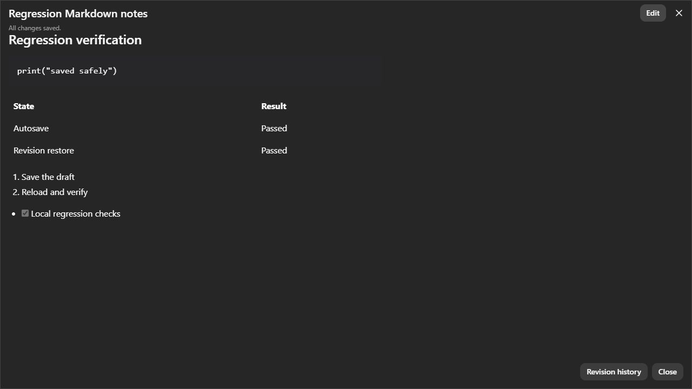
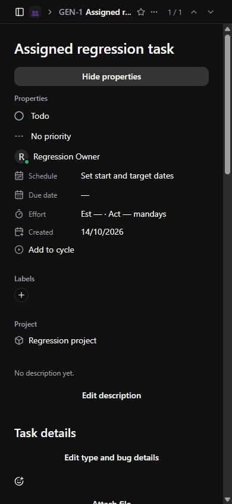

# Flowie — Kế hoạch và nghiệm thu cải tiến ứng dụng

- Phạm vi được người dùng chốt: sửa 17 mục UX và thực hiện 6 đề xuất chức năng.
- Nhánh: `codex/ui-ux-improvements`, bắt đầu từ `68a7f32` trên `main`.
- Trạng thái: **IN_REVIEW — đã triển khai mã nguồn và kiểm thử cục bộ**.
- Chưa phát hành các thay đổi trong tài liệu này lên CT107.
- Báo cáo gốc: [audit ngày 14/10/2026](application-ui-ux-review-2026-10-14.md).
- Quy tắc: mỗi commit có CHANGELOG; Prisma sở hữu schema; production chỉ có CT107.

## 1. Cách quản lý

Owner triển khai là người phụ trách nhánh; reviewer kiểm tra code, kết quả CI và
tiêu chí dưới đây. Release owner chịu trách nhiệm merge và nghiệm thu CT107.
Không tự suy ra tên người hoặc lịch release khi chưa được giao.

Trạng thái từng ID hiện là **IN_REVIEW**: đã có thay đổi và bằng chứng local,
chờ review/CI nhánh. Chỉ đánh dấu **RELEASED** sau khi xác minh commit thực tế
được deploy, migration, readiness và smoke test. Những điều kiện cần hạ tầng hoặc
client bên ngoài được giữ riêng ở mục 6, không tính là đã nghiệm thu production.

## 2. Bảng theo dõi 17 lỗi

| ID | Kết quả triển khai | Module chính | Bằng chứng và tiêu chí review |
| --- | --- | --- | --- |
| UX-01 | Flush khi Done/Close, serialize autosave, giữ bản nháp khi lỗi và kiểm tra version. Có lựa chọn đóng sau khi xác minh backup local. | `features/documents` | Unit autosave; E2E Done nhanh, xung đột, phục hồi offline, restore rồi reload. Storage lỗi phải giữ editor mở. |
| UX-02 | Khóa toàn bộ logical submit và dùng request key cho retry mất phản hồi. | `features/shared/submission-gate`, `features/issues` | Unit double submit; E2E Ctrl+Enter hai lần và retry; DB integration tạo đúng một comment. |
| UX-03 | Nối Releases, SLAs, Customer requests, Asks, Emojis vào UI/API thực. | Routes settings và component quản lý hiện có | E2E tạo bản ghi ở cả năm trang, reload và xác nhận còn dữ liệu; emoji upload dùng storage thử riêng. |
| UX-04 | Profile đọc thành viên thật, creator thật và scope workspace; not-found có đường phục hồi. | `features/members`, workspace navigation | E2E profile tài khoản fixture; unit creator; access tests. |
| UX-05 | Nút Properties mở thuộc tính inline trên mobile, giữ keyboard/focus theo trang. | `features/issues/mobile-issue-properties` | E2E 390px; ảnh sau sửa, combobox status/priority và assignee có tên. |
| UX-06 | Tìm kiếm/filter gửi cùng scope Assigned/Created/Subscribed/Activity và project/team. | `features/issues/issue-query`, issue store | Unit Unicode/scope; API query tests; E2E Assigned không trả issue chưa giao. |
| UX-07 | Datetime API dùng UTC có offset; fallback cho timestamp legacy; formatter dùng chung. | `core/utc_responses`, `lib/time` | Backend UTC tests; unit timestamp/relative time; ảnh tài liệu mới có thời gian phù hợp. |
| UX-08 | Error/empty/loading riêng, Retry giữ query; bảo vệ cache theo tài khoản/workspace; cycle trống có thông báo. | `QueryState`, issue query/store, cycle hook | E2E request lỗi rồi Retry; cycle không có lịch không quay loading vô hạn. |
| UX-09 | Preference thông báo lưu API, optimistic update có rollback; Configure mở Integrations. Snooze chưa hỗ trợ được disable rõ. | notification store/popover | E2E checkbox qua reload; luồng lỗi có phản hồi. Không công bố snooze scheduler đã có. |
| UX-10 | Issue reaction, subscribe, file upload và Help có thao tác thật; comment có picker riêng. | issue activity/attachments, Help | E2E comment attachment download; tests quyền attachments; Help search. MinIO thực cần smoke trước release. |
| UX-11 | GFM chung cho tài liệu, mô tả và comment: code fence, bảng, list/task list; chặn raw HTML và URL nguy hiểm. | `components/common/markdown` | E2E semantic table/code/list và unsafe URL; ảnh sau sửa. |
| UX-12 | Badge project dẫn đến đúng `project/{id}/overview`. | project badge | Kiểm tra route và liên kết từ issue; không dùng ID issue làm project. |
| UX-13 | AI settings hiển thị capabilities/config thật và links liên quan; tên Flowie thống nhất. | AI settings, `features/ai` | E2E project presets/config; API capabilities tests. External coding runner vẫn nằm ở client. |
| UX-14 | Default English; catalog en/vi cho auth và shared states, preference locale, hint Ctrl/⌘ đúng nền tảng. | `features/shared`, UI preferences | Unit locale/platform; root/login tôn trọng home preference. Bản dịch toàn ứng dụng legacy không nằm trong tiêu chí audit này. |
| UX-15 | Labels cho composer/fields/icon actions mới, combobox properties có tên, zoom không bị khóa; semantic Markdown. | Shared UI và issue controls | Axe auth/preferences light/dark; thao tác keyboard trong E2E; mobile 390px. Không tuyên bố WCAG toàn bộ ứng dụng. |
| UX-16 | Batch quan hệ, cursor/filter/search phía server, detail lookup trực tiếp; web tải từng page và giữ scope. | `core/pagination`, `modules/work_items/issue_search`, web query | Cursor/ACL integration; benchmark 1k/10k; UI Load more và tổng từ API. Không cần render 10k dòng cùng lúc. |
| UX-17 | Presence lấy `lastSeenAt`/`isOnline` thay cho offline giả. | API options và assignee/member mapping | Contract/API tests; mobile fixture hiển thị presence thật. Cửa sổ online là 2 phút. |

## 3. Bảng theo dõi 6 chức năng

| ID | Chức năng bàn giao | Hợp đồng và kiểm chứng |
| --- | --- | --- |
| FEAT-01 | History/diff/restore tài liệu dùng chung Web/MCP; expectedVersion, 409, giữ draft và reconcile chủ động. | Không tạo lịch sử Web thứ hai; restore tạo revision mới. E2E concurrent write và restore qua reload; API/DB kiểm tra stale writes. |
| FEAT-02 | Task/Bug, severity, environment, reproduction, expected/actual; form/edit/filter và aggregate report theo quyền. | Migration cho issue legacy mặc định Task; MCP cùng contract. E2E edit bug và đối chiếu API, tests search/report/ACL. |
| FEAT-03 | Author edit/delete, replies một cấp, mention chọn thành viên được phép, notification outbox, edit history và attachment picker. | expectedVersion khi sửa; chỉ tác giả sửa/xóa/upload vào comment; retry web dedup; reply sai issue bị từ chối. UI và DB integration. |
| FEAT-04 | Forgot/reset password với delivery SMTP riêng, token hash một lần/TTL 15 phút, rate limit DB, không lộ email tồn tại. | Reset tăng authVersion, thu hồi sessions/API keys/MCP tokens và đóng sockets hiện hữu. Tests TTL/replay/concurrency/revocation. UI nêu rõ khi SMTP chưa cấu hình. |
| FEAT-05 | Preset read-only/coding theo project; config local token-free cho Codex/Cursor/Claude Code; probe initialize/tools/grants; run evidence và cancel theo quyền. | Token mới chỉ dùng trong phiên, config tham chiếu biến môi trường. SDK/transport và permission tests; E2E preset/config. Nghiệm thu client desktop thực tế là bước riêng. |
| FEAT-06 | Shared query/error/empty, submission guard, Markdown, theme cascade, locale/preferences và hồi quy bằng fixture. | Build/lint/types, unit và E2E trong CI. Astryx dùng cho module mới; legacy tiếp tục dùng contract/theme chung. Không coi đây là rewrite toàn bộ giao diện. |

## 4. Kiến trúc và cách chia commit

Web phân tách theo tính năng:

- `features/documents`: controller autosave, bản nháp có version, API history và UI history.
- `features/issues`: query/pagination, bug form/details/report, activity, comment rows/mentions và attachment state.
- `features/members`: dữ liệu profile/scoped membership.
- `features/ai`: presets, config client, endpoint probe và setup UI.
- `features/identity`: form recovery, gọi API và trạng thái availability.
- `features/shared`: logical submission gate, locale/catalog và phím tắt theo nền tảng.
- `lib/http`, `lib/time`: response envelope/error và timestamp formatter.
- Store giữ snapshot/scope/epoch; route ghép các module, không chứa SQL hoặc nghiệp vụ backend.

Backend giữ API domain làm adapter, dùng service chung trong `modules`:

- `work_items`: issue/comment/document contracts, repository, history, bug report và search.
- `identity`: rate limit, reset token và private email delivery.
- `mcp`: adapter tool gọi cùng nghiệp vụ và ACL với Web.
- `agent_runs`: access-scoped evidence và cancellation.
- `core`: UTC response boundary và cursor được ký/bind vào người dùng/query.

Các commit được chia theo lỗi hoặc chức năng, sau đó tách performance backend/web,
regression/CI, schema alignment và tài liệu nghiệm thu. Xem `git log
origin/main..codex/ui-ux-improvements`; mọi commit có entry cùng thay đổi trong
`CHANGELOG.md`. Không squash bắt buộc trước review; giữ lịch sử giúp kiểm tra từng module.

### Migration bắt buộc

Áp dụng qua Compose `migrate`, giữ nguyên dependency trước `api` và `worker`:

1. `20261014140000_structured_bugs`: issue type/severity và nội dung bug.
2. `20261014143000_comment_threads_history`: parent/mentions/revision trigger, backfill history.
3. `20261014150000_web_comment_deduplication`: request key unique theo tác giả.
4. `20261014153000_password_recovery`: authVersion và rate limits.
5. `20261014160000_issue_pagination_index`: index cho query issue theo cursor.

Schema Prisma cũng đã bổ sung default/index có sẵn trong migration legacy.
Đối chiếu schema với database đã áp dụng 84 migration hiện trả **No difference detected**;
không phát sinh thao tác thay đổi production để sửa các khai báo này.

## 5. Bằng chứng nghiệm thu local

| Kiểm tra | Kết quả | Giới hạn |
| --- | --- | --- |
| Backend/MCP/DB | 102 passed, 2 skipped, 10 subtests passed | Hai integration test cũ bỏ qua theo điều kiện suite; không tính là đã qua. PostgreSQL 16 trên loopback, dữ liệu thử. |
| Web unit | 15 passed | Autosave, submit, timestamp, scope/Unicode, query, config, locale và home navigation. |
| Production build | Pass, gồm lint và TypeScript | Không suy ra readiness CT107 từ build. |
| E2E Chromium | 14 workflow với fixture API/DB thật | Storage trong harness dùng adapter process-local, không thay production S3 adapter. |
| Accessibility | Axe auth/preferences; responsive properties và keyboard critical flows | Không phải chứng nhận WCAG cho mọi screen. |
| Database | Clean 84 migrations, upgrade/test DB, Prisma diff không sai lệch; generate pass | Production chạy migration bởi workflow. |
| Python static checks | Ruff F cho modules và F821 cho app pass | Phạm vi rules theo workflow hiện có. |
| Compose | `docker compose --profile app config --quiet` pass | Docker daemon local chưa chạy; không giả định đã kiểm thử full Compose. |

[Benchmark](issue-query-benchmark-2026-10-14.md) ghi phương pháp và từng số đo:
truy vấn page đầu 100 issue ở dataset 10k có p95 khoảng 79 ms và 9 SQL queries;
baseline hydrate toàn bộ có p95 khoảng 20,4 giây và 60.004 queries. Đây là thời gian
service/SQL trên dữ liệu tổng hợp, chưa gồm HTTP, rendering hoặc tải production.

Chạy lại hồi quy:

```powershell
$env:MCP_TEST_DATABASE_URL = 'postgresql://flowie_test@127.0.0.1:55439/flowie_test_database'
.venv/Scripts/python.exe -m pytest apps/api-python/tests -q
pnpm --filter @circle/web test:unit
pnpm --filter @circle/web build
$env:FLOWIE_E2E_DATABASE_URL = $env:MCP_TEST_DATABASE_URL
$env:FLOWIE_E2E_PYTHON = '../../.venv/Scripts/python.exe'
python scripts/seed-ui-regression.py
pnpm --filter @circle/web exec playwright install chromium
pnpm --filter @circle/web test:e2e
```

Database trong ví dụ phải được tạo riêng và áp dụng Prisma migrations trước seed.
Seed/harness chỉ chấp nhận loopback, user `flowie_test`, database có prefix `flowie_`.
Fixture credential tổng hợp được ghi vào file ignored; không dùng tài khoản thật.
CI Ubuntu tự tạo database, áp dụng migration, build và chạy E2E; trace lỗi giữ 7 ngày.

Ảnh sau sửa chụp dữ liệu thử:





## 6. Điều kiện trước khi phát hành CT107

- [ ] Review branch/PR và CI pass đúng head commit; kiểm tra CHANGELOG trong từng commit.
- [ ] Xác nhận snapshot/backup DB production theo runbook hiện hữu, không sửa schema trực tiếp.
- [ ] Cấu hình `SMTP_HOST`, `SMTP_PORT`, `SMTP_FROM`, thông tin đăng nhập cần thiết và TLS; `APP_URL` của API là URL HTTPS thật (Compose lấy từ `NEXT_PUBLIC_APP_URL`). Test private delivery tới tài khoản thử do release owner quản lý.
- [ ] Kiểm tra MinIO thực: upload/download issue, comment và emoji qua quyền tương ứng. Harness E2E không chứng minh kết nối object storage production.
- [ ] Kiểm tra preset/MCP read-only hoặc write theo flags đã cấu hình; token giới hạn project/team. Không tăng quyền để bỏ qua lỗi client.
- [ ] Nghiệm thu từng client desktop đã chọn: initialize, discover, read đúng project, thử write được cấp quyền và deny ngoài scope; không đưa token vào tài liệu/log/commit.
- [ ] Sau merge được cho phép: workflow production triển khai đúng SHA, migrate thành công trước api/worker, readiness và smoke test các luồng chính.
- [ ] Nếu tạo release: promote Unreleased, tăng version, deploy đúng release commit; chỉ tag annotated và publish release sau xác minh deployment.

Run evidence là dữ liệu agent báo cáo, không tự chứng minh test/PR phía repository
đã đạt. Coding agent và SCM credential chạy ở client ngoài Flowie. SMTP chưa cấu
hình thì recovery chưa khả dụng; giao diện phải tiếp tục báo rõ, không giả gửi email.

Không bật scheduler snooze, runner tự thực thi repository hoặc bản dịch toàn bộ
legacy trong nhánh này; các tiêu chí audit tương ứng yêu cầu capability rõ ràng,
scope đúng và không có control giả. Những phần mở rộng này cần kế hoạch sản phẩm riêng.
